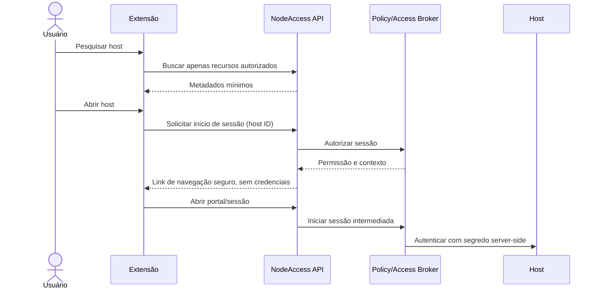
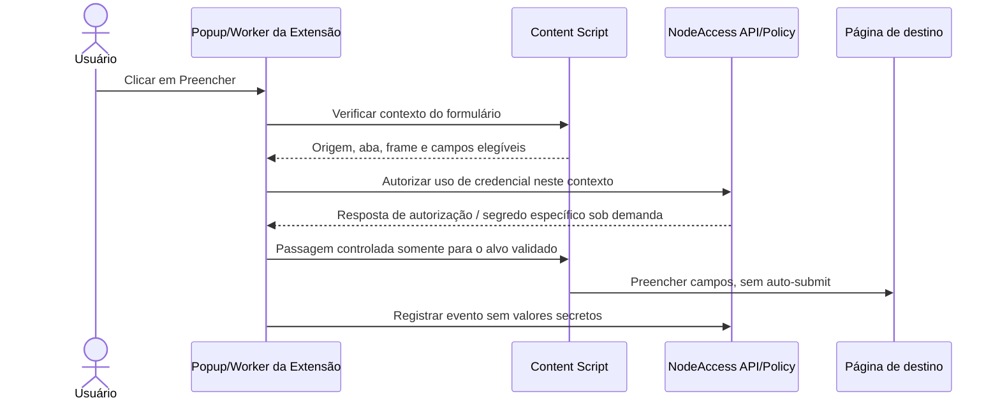
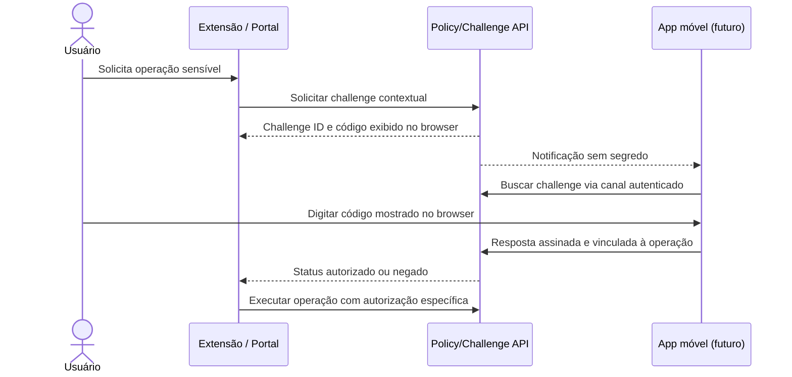
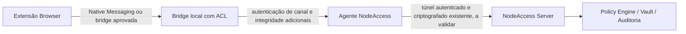
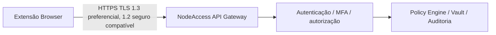

# NodeAccess — RFC de Análise: Cofre Unificado e Extensão de Navegador

> **Status:** RFC v4 — proposta para avaliação técnica (não aprovada para implementação)\
> **Público:** Codex / engenharia / arquitetura / produto / segurança\
> **Idioma:** Português (Brasil)\
> **Prioridade:** Segurança, simplicidade de uso e desempenho, nessa ordem, sem comprometer a viabilidade operacional.

## 1. Instrução inicial para o Codex

Você está analisando o repositório **NodeAccess**. **Antes de alterar qualquer arquivo, faça uma investigação do código real**. Não presuma que os componentes, frameworks, políticas ou endpoints descritos neste documento já existam. Identifique o que existe, o que pode ser reutilizado e o que precisa ser criado. **Não implemente nada nesta primeira etapa** e não execute migrações, alterações em infraestrutura ou operações destrutivas.

Produza uma avaliação crítica e baseada em evidências do repositório. Referencie arquivos, módulos, funções e, quando possível, linhas que fundamentem cada conclusão. Sinalize explicitamente hipóteses e pontos não verificados.

### Entregáveis da primeira etapa

1. **Diagnóstico AS-IS:** fluxo atual de `Secrets` e `Chaves PEM`, permissões, armazenamento, criptografia, auditoria, autenticação e relação com hosts/grupos/empresas.
2. **Análise de lacunas (GAP):** diferenças entre arquitetura atual e requisitos deste RFC, com gravidade e risco.
3. **Opções arquiteturais (mínimo 2):** reaproveitamento incremental versus módulo de Cofre dedicado; trade-offs, migração, custo e manutenção.
4. **Modelo TO-BE:** proposta de domínio, entidades, APIs, fluxos e limites de confiança, com diagramas Mermaid.
5. **Threat model:** ativos, atores, trust boundaries, ameaças e mitigações; priorize riscos de extensão, multi-tenant e autofill.
6. **UX proposta:** principais fluxos e estados (sucesso, erro, offline, sem permissão, sessão expirada), sem excesso de interface.
7. **Plano incremental:** fases, dependências, critérios de aceite, testes e plano de rollback.
8. **Perguntas em aberto e decisões arquiteturais (ADRs)** que precisam de aprovação humana.
9. **Avaliação de UX equivalente aos fluxos úteis de 1Password**, sem copiar a interface, e plano de coexistência com gerenciadores nativos Chrome/Edge/Firefox.
10. **Contratos de cadastro reutilizáveis** entre portal e extensão, incluindo criação/edição de URLs, senhas, SSH/PEM e Secrets.
11. **Preparação para aprovador móvel futuro**, sem implementar app/push agora, com API/estado de desafios separáveis da autenticação atual.
12. **Inventário do agente NodeAccess existente:** protocolos, endpoints, autenticação mútua, túnel, capacidade de comunicação com extensões e limitações Windows/Linux/macOS.
13. **Matriz de comunicação com e sem agente:** modelo de ameaça, requisitos TLS, canal local, pareamento, rotação, disponibilidade, fallback e critérios de seleção.
14. **Plano de bloqueio e reautenticação do Cofre na extensão:** senha, WebAuthn/passkeys, Windows Hello, Touch ID e alternativas Linux; políticas por risco e plataforma.
15. **Revisão do modelo de sessão:** duração absoluta, inatividade, step-up, revogação, lock de estação e perfil do navegador; diferenciar desbloqueio local de autenticação verificada pelo servidor.

16. **Consolidação da interface no portal:** mapear telas existentes de `Secrets` e `Chaves PEM`, propor tela única **Cofre** com pesquisa, filtros, criação tipada, edição, relações e compatibilidade com links/rotas anteriores; evidenciar preservação de segurança e dados.

**Regra de trabalho:** primeiro analise e reporte. Aguarde autorização explícita para implementar.

---

## 2. Contexto e objetivo

O NodeAccess é uma plataforma de acesso operacional a infraestrutura, com hosts e mecanismos de acesso remoto. Há funcionalidades chamadas **Chaves PEM** e **Secrets**. A proposta é criar uma experiência de **Cofre**, que unifique a descoberta e a gestão de credenciais/segredos, sem necessariamente misturar suas estruturas de armazenamento ou flexibilizar controles de segurança.

Como evolução, pretende-se criar uma **extensão de navegador** semelhante, em conveniência, a gerenciadores de senhas, mas com proposta própria: **cofre corporativo com experiência de descoberta, cadastro e preenchimento tão fluida quanto os fluxos relevantes do 1Password**, preservando a identidade do NodeAccess e sem reproduzir obrigatoriamente todo seu catálogo de funções.

**Restrição declarada pelo produto:** nos fluxos atuais relevantes, credenciais são inseridas/utilizadas pelo backend e não chegam ao navegador. **Verificar isso no código**, inclusive nos caminhos de exceção, logs, WebSocket, exportação e console. Preservar esse princípio para SSH/RDP e demais acessos intermediados sempre que viável.

### Objetivos

- Localizar hosts, IPs, URLs, aplicações e credenciais de forma rápida.
- Abrir diretamente um recurso no portal/sessão NodeAccess, com autorização centralizada.
- Associar credenciais web a URLs e, quando aplicável, a hosts/empresas/grupos.
- Oferecer preenchimento web **somente sob demanda e quando tecnicamente seguro dentro dos limites do navegador**.
- Permitir cadastrar e atualizar, no portal **e na extensão**, URLs, credenciais web, senhas de host, chaves SSH/PEM e Secrets, reaproveitando **a mesma regra de negócio, políticas e contratos seguros do backend**, sem duplicar lógica crítica.
- Possibilitar salvar credenciais novas com consentimento e validações explícitas; associá-las a URL, host, aplicação e escopo corporativo.
- Oferecer sugestão contextual/autofill semelhante ao conforto do 1Password, **sem competir agressivamente com os prompts e sugestões nativos do navegador**.
- Preparar abstração para aprovação futura por aplicativo móvel (push + desafio numérico/transferência de código), **sem exigir implementação agora**.
- Preservar auditoria, RBAC/ABAC, isolamento multi-tenant e Zero Trust.
- Manter extensão leve, discreta, acessível e com pouca poluição visual.

### Não objetivos iniciais

- Construir um gerenciador de senhas pessoal generalista completo; **a experiência web de cadastro, busca, sugestão e preenchimento de credenciais corporativas é, sim, objetivo explícito**.
- Sincronizar ou baixar o Cofre inteiro no navegador.
- Expor chaves privadas SSH/PEM ao browser para fluxos intermediados.
- Implementar passkeys, rotação universal, PAM/JIT completo ou gravação de toda navegação no MVP.
- Monitorar indiscriminadamente formulários, teclas, histórico de navegação ou páginas não relacionadas.

---

## 3. Princípios inegociáveis

1. **Backend como autoridade:** autenticação, autorização, uso de credenciais, políticas e auditoria devem permanecer centralizados.
2. **Segregação de tenants:** nenhum usuário, grupo ou integração pode obter metadados ou segredos de outra empresa sem autorização explícita.
3. **Privilégio mínimo:** extensão, permissões Chrome, tokens, endpoints e contas técnicas com escopo mínimo.
4. **Não persistir segredos no browser:** não armazenar senhas, tokens de API sensíveis, PEM ou seed TOTP em storage persistente da extensão, logs ou telemetria. **Ao cadastrar um segredo novo pelo plugin, ele necessariamente passa temporariamente pelo browser como entrada do usuário**; enviar ao backend por canal autenticado, minimizar sua permanência em memória e jamais alegar que esse cadastro é exclusivamente server-side.
5. **Uso sob demanda:** nenhum segredo deve ser revelado por pré-carregamento, pesquisa, listagem ou mudança de aba.
6. **UX silenciosa:** sem popup automático intrusivo, overlay persistente ou prompts repetitivos.
7. **Segurança verificável:** controles acompanhados de testes e evidências; não tratar rótulos como “criptografado” ou “Zero Trust” como prova suficiente.
8. **Compatibilidade e migração:** objetos e acessos existentes continuam funcionando; mudanças devem ter rollback claro.

**Limite de segurança importante:** no caso de autofill em um site externo com usuário/senha, o segredo inevitavelmente chega ao contexto de autenticação da página. Scripts da página comprometida podem capturá-lo. O projeto deve documentar esse risco residual. Em fluxos SSH/RDP intermediados, priorizar arquitetura em que a credencial nunca chega ao navegador.

---

## 4. Conceito de domínio: Cofre

Criar **Cofre** como agrupador de UX e política, preservando tipos distintos e controles específicos. Tipos candidatos:

| Tipo | Exemplo | Regra principal |
|---|---|---|
| Credencial web | login/senha | Origem/URL autorizada, autofill controlado |
| Credencial de host | usuário/senha de SSH/RDP | Uso pelo backend quando intermediado |
| Chave SSH/PEM | chave privada | Uso server-side sem revelar chaves existentes; no cadastro/importação via plugin o arquivo é transitado explicitamente uma única vez ao backend |
| Secret/API token | token de integração | Uso server-side preferencial |
| Certificado | CRT/P12/PFX | Avaliar armazenamento e ciclo de vida separadamente |
| TOTP | seed/OTP | **Fora do MVP**, exige threat model específico |
| Nota segura | informação confidencial | **Fora do MVP** |

### Relações e política

- Um item do Cofre pode se relacionar a **zero, um ou vários hosts**, aplicações ou URLs, conforme política e tipo.
- Definir escopo por **empresa/tenant**, grupos, papéis e usuário; não assumir que uma chave usada em vários hosts pertence automaticamente a todos.
- Separar `pode usar`, `pode preencher`, `pode revelar`, `pode editar`, `pode compartilhar`, `pode administrar` e `pode auditar`.
- Preferir referências/IDs de segredos nas relações, evitando duplicação do valor criptografado.
- Definir ciclo de vida: criação, atualização, rotação, revogação, exclusão e auditoria.
- Avaliar se o nome `Secret` deve continuar como subtipo técnico do Cofre.

### Requisito obrigatório de UX: uma única tela Cofre no portal (RF-COFRE-UI-01)

**Objetivo explícito:** substituir `Secrets` e `Chaves PEM` como **duas áreas independentes da navegação principal** por uma única entrada **Cofre**. Isso é uma **consolidação de experiência**, não uma autorização para fundir tabelas, enfraquecer RBAC ou migrar material criptográfico sem necessidade.

**Estrutura proposta da tela única:**

- **Menu:** uma entrada principal `Cofre`; subtipos podem existir como filtros, abas leves ou atalhos, mas não como módulos administrativos duplicados.
- **Lista central:** apresentar itens autorizados de todos os tipos com nome, tipo, escopo, associação, status e ações permitidas **sem valores secretos**.
- **Pesquisa e filtros:** buscar por nome, descrição e metadados autorizados; filtrar por tipo (`Todos`, `Senhas`, `Chaves SSH/PEM`, `Secrets`, `URLs` e tipos futuros), tenant/empresa, grupo, host/aplicação/URL, tags, proprietário e status quando disponíveis. Filtros devem respeitar autorização e isolamento multi-tenant, sem revelar existência de itens fora do escopo.
- **Ação primária `+ Novo item`:** abrir seletor de tipo e formulário contextual (credencial web/URL, senha de host, chave SSH/PEM, Secret/API token; outros tipos somente quando habilitados). O formulário mostra apenas campos pertinentes e oferece associação a host(s), URL(s), empresa/grupo e política.
- **Editar / associar / revogar / excluir:** ações contextualizadas por tipo e permissão. Exibição, cópia ou exportação de valores sensíveis **não são implícitas**; preservar a política de não exposição de PEM existente ao navegador.
- **Mesma lógica no portal e extensão:** compartilhar contratos de domínio, validação de API, RBAC/ABAC, auditoria, associações e regras de negócio. Pode haver componentes de UI diferentes para largura/tarefa distintas; **não duplicar lógica sensível no frontend**.
- **Sinalização útil:** estados vazios, item expirado/revogado, falha de autorização, confirmação de ações destrutivas e feedback discreto; evitar menus ou modais redundantes.
- **Compatibilidade:** mapear todas as rotas, botões, links, permissões, associações e fluxos que apontam para telas antigas; planejar redirecionamentos internos/URLs legadas, migração de navegação e reversão sem perda de dados. Preservar IDs e referências consumidos por hosts, sessões, APIs e integrações. Não eliminar APIs antigas antes de avaliar dependências e oferecer depreciação versionada quando aplicável.
- **Migração segura de UX:** exibir os objetos atuais no Cofre sem recriptografar ou recriar registros por padrão. Alteração de schema apenas se a inspeção do repositório demonstrar necessidade real, com migração reversível, backup e testes de regressão.

**Fluxos que o Codex deve prototipar:**

1. `Menu Cofre → Todos → pesquisar → filtrar → abrir detalhes não sensíveis → ação autorizada`.
2. `Cofre → + Novo item → selecionar tipo → preencher → associar host/URL → salvar → ver item na lista`.
3. `Host existente → credencial vinculada → abrir item no Cofre → voltar ao host`, sem perder contexto.
4. `Extensão → criar/editar item → API existente → item imediatamente visível no Cofre do portal`, respeitando invalidação de cache e permissões.
5. `Link antigo de Secrets/PEM → destino compatível no Cofre`, sem expor material secreto.

**Critérios de aceite da consolidação:** uma entrada central de navegação; tipos existentes localizáveis, editáveis e utilizáveis conforme permissões; associação com hosts preservada; nenhuma alteração involuntária de valor ou chave armazenada; nenhuma exposição nova de segredo; fluxos e referências antigos preservados/redirecionados; testes RBAC/multi-tenant e regressão aprovados; funcionalidades do portal e extensão operam sobre a mesma fonte de verdade.

### Questões para inspeção

- Onde e como os dados são criptografados em repouso e transportados?
- Onde ficam as chaves criptográficas e quem pode acessá-las?
- Como funciona a autorização para usar uma PEM ou Secret hoje?
- Há associação de credencial a host, tenant, grupo e sessão? Como é validada?
- Existe endpoint de `reveal` ou exportação? Quem o utiliza?
- Há risco de segredo escapar por exceções, debug, trace, logs, WebSocket ou backups?
- Há trilha de quem **usou** o segredo sem conhecer seu conteúdo?

---

## 5. Extensão: proposta funcional

**Base técnica a avaliar:** Manifest V3 para Chrome/Chromium, com popup/action, service worker e content scripts sob demanda. Verificar estratégia para Firefox/Edge como fase posterior; não assumir compatibilidade automática.

### MVP de menor risco

| Capacidade | Comportamento esperado |
|---|---|
| Autenticação | SSO/sessão própria e escopos específicos para extensão; validar OIDC/OAuth + PKCE se aplicável |
| Pesquisa | Buscar hosts por nome, IP, empresa, tag, grupo; buscar URLs/aplicações autorizadas |
| Contexto da aba | Reconhecer URL/origem de página autorizada quando o usuário aciona a extensão |
| Abrir host | Acionar o backend/portal para uma sessão com autorização server-side, sem passar segredos em URL |
| Favoritos/recentes | Acessos frequentes e recentes conforme autorização atual |
| UI | Estado silencioso; ícone discreto; popup simples; nenhum overlay inicial obrigatório |
| Auditoria | Registrar acessos, solicitações e operações sensíveis; jamais registrar valores secretos |

### MVP expandido, condicionado a revisão de segurança

| Capacidade | Política |
|---|---|
| Click-to-fill | Somente após gesto explícito; sem auto-submit por padrão |
| Múltiplas credenciais | Mostrar rótulos e identidades autorizadas, nunca senhas na lista |
| Salvar login novo | Consentimento e seleção explícita de empresa, escopo e URL; sem captura indiscriminada |
| Cadastro pelo plugin | Criar/editar URL, login web, credencial de host, Secret e importar chave SSH/PEM; mesmos DTOs, validações, RBAC e auditoria do portal |
| Sugestões de preenchimento | Preferir popup/contexto acionado pelo usuário; indicador inline apenas opcional e testado contra gerenciadores nativos |
| Indicador em campo de login | Opcional e desativável, com mínima intrusão |
| Solicitar acesso | Quando recurso existir mas acesso estiver bloqueado, sem divulgar metadados indevidos |

### Funcionalidades posteriores

Favoritos avançados, JIT, aprovação temporária, rotação, geração de senha, análise de reutilização, suporte a passkeys, integração IdP e fluxos de acesso web sem compartilhamento de senha quando suportados.

---

## 5A. Experiência de cofre semelhante ao 1Password — requisitos adicionais

**Orientação de produto:** o usuário deve conseguir **cadastrar, encontrar, atualizar e usar** credenciais diretamente pelo popup/side panel quando apropriado, sem sair do fluxo de trabalho; o portal continua sendo a interface de administração de massa, governança e auditoria. Não copiar branding ou componentes visuais de terceiros.

### 5A.1 Tipos e formulários unificados

| Tipo no plugin | Campos iniciais | Associações / uso | Cuidados |
|---|---|---|---|
| Login web | título, URL(s), usuário, senha, notas opcionais | origem exata, tenant, aplicação/host | senha mascarada; sem autosubmit; revisão da origem |
| Host SSH/RDP | título, usuário, referência ao host, método | host/grupo/tenant | reaproveitar fluxo de credencial server-side |
| Chave SSH/PEM | título, importação de arquivo ou texto, passphrase quando aplicável, algoritmo/tipo | host(s), escopo, política | **importação é envio consciente ao backend**; nunca oferecer download/reveal de PEM existente como padrão |
| Secret/API Key | título, tipo, valor, metadados | aplicação/host/integração | não sugerir preenchimento em campo web arbitrário |
| URL/link sem segredo | título, URL, classificação, host/cliente | busca e abertura | não inventar credencial se não há uma |

Verificar como o projeto já nomeia e valida esses objetos; **um mesmo formulário de domínio não significa que todos os segredos tenham as mesmas operações de exposição**. O Codex deve recomendar contratos de API reutilizáveis e componentes de UI compartilháveis, mas os componentes visuais da extensão podem ser mais compactos.

### 5A.2 Fluxos de cadastro previstos

1. **Criar pela extensão:** abrir popup → `+ Novo` → selecionar tipo → formulário progressivo → escolher empresa/pessoal (se autorizado), host/URL e política → salvar no backend → feedback conciso.
2. **Salvar credencial web existente:** usuário aciona `Salvar login deste site` → plugin sugere URL/origem atual e usuário **confirma** → digita ou seleciona explicitamente credencial autorizada → backend deduplica/valida → salva; sem coleta indiscriminada dos campos digitados.
3. **Importar chave PEM/SSH:** usuário escolhe arquivo ou cola conteúdo voluntariamente → checagem de tipo/tamanho/algoritmo → transmissão segura → backend armazena usando mecanismo já adotado → extensão apaga referências em memória quando possível; **não prometer eliminação perfeita da memória**.
4. **Editar:** listar metadados → editar campos autorizados → para valores criptográficos, substituição explícita em vez de exibir valor atual. Requer policy check e auditoria.
5. **Associar URL a host:** permitir várias URLs por item e referências N:N, evitando duplicação do segredo; impedir que uma associação expanda permissões de acesso automaticamente.
6. **Cadastro com duplicidade:** diferenciar URL já existente, credencial distinta para a mesma URL e item idêntico; oferecer associar, atualizar ou cancelar sem sobrescrever silenciosamente.

### 5A.3 UX de sugestão e preenchimento sem competir com o navegador

**Meta:** uma experiência similar à conveniência do 1Password, respeitando que navegadores e outros gerenciadores possuem interfaces nativas que uma extensão **não consegue controlar consistentemente**. Não há garantia universal de conflito visual zero.

- **Modo padrão: discreto e manual.** Botão do plugin, atalho/command palette e ação `Preencher`; a extensão não cobre nem disputa o dropdown nativo de senhas.
- **Modo inline opt-in por usuário/empresa:** pequeno indicador ao lado do campo, com reposicionamento e opção `Não mostrar neste site`; nunca interceptar agressivamente o foco ou sobrepor sugestões nativas.
- **Preferência por site:** `NodeAccess`, `Somente manual`, `Não sugerir`. Se outro gerenciador dominar o campo, permitir fallback pelo popup; sem tentar desativar recurso do browser.
- **Autocomplete e heurísticas:** respeitar semântica HTML e padrões dos campos; **não alterar `autocomplete`, desabilitar gerenciador nativo ou reescrever DOM globalmente** para forçar a preferência pelo NodeAccess. Não prometer que atributos de formulário resolverão todas as colisões.
- **Múltiplas contas na URL:** mostrar título e usuário; `Preencher` seleciona uma única credencial, nunca a primeira indiscriminadamente.
- **URL matching seguro:** normalizar IDN/punycode, porta, esquema, redirects, subdomínios, URLs com IP, host interno; evitar wildcard amplo e spoofing de domínios visualmente semelhantes; regras especiais exigem revisão/consentimento.
- **Formulários complexos:** login em duas etapas (usuário → senha), SPA com DOM dinâmico, shadow DOM, iframes, campos de senha em formulários de alteração/reset e múltiplas abas; não preencher fora de contexto reconhecido.
- **Salvar após login:** avaliar tecnicamente detecção não invasiva; se exigir leitura de credenciais em forms, oferecer **somente modo opt-in, por domínio autorizado**, threat model e transparência. Para MVP, preferir `Salvar` manual.
- **Prioridade de UX:** 1) abrir host ou URL; 2) preencher login autorizado; 3) salvar/editar item; 4) funções administrativas ficam no portal.
- **Interface:** menu curto com `Pesquisar`, `Página atual`, `+ Novo`, `Recentes`, `Configurações` (secundário); suportar teclado, leitores de tela, contraste e foco.

### 5A.4 Comportamento por situação

| Situação | Comportamento |
|---|---|
| Site tem 1 credencial autorizada | ação `Preencher` evidente no popup, sem prompt invasivo |
| Site tem 2+ credenciais | escolha compacta por usuário/título |
| Site ainda não está no Cofre | `Salvar login` ou `Cadastrar URL`, sem captura passiva |
| Usuário tenta cadastrar PEM | wizard mínimo, upload protegido, associação com host, sem preview da chave depois de salvar |
| Gerenciador nativo sugere senha | NodeAccess permanece discreto, sem popup sobreposto |
| URL é phishing/punycode suspeito | não sugerir nem preencher, comunicar motivo |
| Sessão expirada durante cadastro | não persistir segredo localmente como rascunho; permitir reautenticar antes de entrada sensível |
| Sem permissão de gestão | mostrar apenas ações permitidas; não vazar existência de itens restritos |

### 5A.5 Critérios de aceitação de UX e compatibilidade

- Testar Chrome e Edge com gerenciador nativo **ligado e desligado**, além de ao menos um gerenciador terceiro instalado em ambiente de testes.
- Não forçar desativação do preenchimento nativo para instalar/usar o NodeAccess.
- Validar que clicar no campo não cria dois menus NodeAccess/nativo sobrepostos em modo padrão.
- Cadastro/edição possuem política idêntica à do portal: autorização no backend, validação, versionamento e auditoria.
- Medir cliques até salvar e preencher, erros, taxa de sucesso, latência, acessibilidade e falsos positivos.
- Testar regressão em formulários HTML comuns e em SPA; preservar comportamento do site de destino.

---

## 6. Segurança do autofill: requisitos obrigatórios

1. Verificar **origem efetiva (`scheme`, `host`, `port`)**, aba e frame no momento da solicitação e novamente imediatamente antes do preenchimento.
2. Correspondência `exact origin` ou `exact hostname` como padrão (definir política por tipo); subdomínios devem exigir configuração explícita. Não usar regex irrestrito como default.
3. Bloquear HTTP por padrão. Exceções para aplicações legadas internas exigem aprovação de política e risco documentado.
4. Não preencher iframes de terceiros, campos ocultos, páginas inesperadas ou contextos com ambiguidade de origem.
5. Usar autorização por operação no backend, com avaliação de usuário, tenant, sessão, dispositivo, alvo e política.
6. Uma autorização de uso único **não torna reutilizável uma senha de uso único**; distinguir token de autorização de segredo real.
7. Entregar apenas o segredo individual solicitado, pelo menor período possível, sem persistir em `localStorage`, `chrome.storage.local`, IndexedDB, logs, telemetria, clipboard ou URL.
8. Preferir content scripts isolados e comunicação autenticada/validada; tratar todo dado da página e mensagens dos scripts como **não confiáveis**.
9. Não carregar scripts remotos, não usar `eval` e aplicar CSP estrita adequada ao Manifest V3.
10. Não realizar envio automático do formulário por padrão.
11. Definir resposta segura a navegação durante o fluxo, alterações de aba, logout, revogação de permissão e sessão expirada.
12. Documentar risco residual de JavaScript da página obter uma senha após preenchimento, mesmo com content script isolado.
13. Exigir revisão de ameaças para opções de salvar senhas e detecção de login; consentimento claro e proibição de monitoramento genérico.
14. Testar confusão entre contas, hosts, empresas e credenciais compartilhadas.

**Não afirmar que “nunca chega ao navegador” para credenciais de web autofill.** Afirmar isso somente para modalidades concretas em que a implementação realmente mantém o segredo server-side.

---

## 7. Proposta de experiência (UX/UI)

### Estados principais

- **Discreto (padrão):** sem interrupção; o usuário abre a extensão quando precisa.
- **Página atual:** nome/URL, empresa, ambiente (produção/homologação/dev), credenciais disponíveis e ação principal.
- **Pesquisa:** campo único para host, IP, URL, serviço e tag; resultados rápidos e agrupados com parcimônia.
- **Acesso negado:** motivo compreensível e possibilidade de solicitar acesso, se suportada.
- **Sessão expirada:** reautenticação clara sem perder a intenção da tarefa.
- **Sem conexão:** informar indisponibilidade; não mostrar segredo armazenado offline.
- **Nenhum resultado:** explicar e sugerir ação útil, não tela vazia confusa.

### Diretrizes

- Uma ação principal por contexto; ações secundárias em menu.
- Não duplicar área administrativa do NodeAccess no popup.
- Respeitar acessibilidade de teclado, contraste e leitor de tela.
- Não exibir credenciais para as quais o usuário não tem permissão.
- Não solicitar MFA indiscriminadamente; aplicar step-up somente quando política/risco exigir.
- Não repetir aviso dispensado, respeitando regras de segurança e consentimento.
- Produção deve ser claramente diferenciada sem depender apenas de cor.
- Diferenciar `abrir`, `usar`, `preencher`, `revelar` e `copiar` — operações com riscos distintos.
- Instrumentar taxa de sucesso, erros e esforço de interação, sem coletar dados sensíveis.

---

## 8. Performance e resiliência

**Metas de engenharia iniciais (validar em laboratório e produção):**

| Métrica | Meta P95 |
|---|---:|
| Abertura do popup | ≤ 300 ms |
| Pesquisa em metadados cacheados | ≤ 100 ms |
| Pesquisa remota | ≤ 500 ms |
| Reconhecimento contextual após ação | ≤ 200 ms |
| Preenchimento após autorização concluída | ≤ 700 ms |

- Paginação, debounce e cancelamento de busca em progresso.
- Cache com TTL apenas de **metadados não sensíveis**; invalidar em revogação/mudança de permissão, troca de tenant e logout.
- Cuidado: nome de host, cliente e URL **podem ser confidenciais**, mesmo sem senha. Aplicar política de minimização e não persistir dados corporativos desnecessariamente.
- Não manter content scripts ativos em todas as páginas sem justificativa; preferir execução sob demanda ou escopos bem definidos.
- Service workers podem ser suspensos; arquitetura não deve depender de estado em memória permanente.
- Deduplicar chamadas, aplicar rate limit, backoff e tratamento consistente de falhas.
- Validar em cenários de VPN/WARP, rede lenta, grandes inventários e múltiplos tenants.

---

## 9. Fluxos desejados

### 9.1 Pesquisa e abertura de host (sem segredo no browser)

### 9.2 Autofill web (exceção controlada)

> A segurança depende do desenho real de mensagens, isolamento de contexts, permissões e revogação. O diagrama não implica proteção contra scripts maliciosos já executados pela página de destino.

---

## 9A. Preparação para aprovação futura por aplicativo móvel (não implementar no MVP)

**Intenção:** no futuro, permitir que um aplicativo NodeAccess associado à identidade do usuário aprove solicitações sensíveis de login, uso de segredo, acesso a host de produção, elevação de privilégio ou operação de alto risco. Esta é apenas uma **previsão de extensibilidade arquitetural**, não compromisso de criar o aplicativo.

### Modelo lógico proposto

- Criar conceito de `ApprovalChallenge` ou `AuthorizationChallenge` separado do mecanismo de login, com `challengeId`, usuário, tenant, finalidade, recurso, operação, contexto de risco, expiração, contador de tentativas, status e trilha de auditoria.
- Estados recomendados: `CREATED`, `DELIVERED`, `AWAITING_USER`, `APPROVED`, `DENIED`, `EXPIRED`, `CANCELLED`, `CONSUMED`; transições atômicas e consumo único.
- Interface abstrata de fatores/aprovadores (`WebAuthn`, `TOTP` se existente, `MobileApproval` no futuro) e políticas de step-up sem dependência do app móvel específico.
- O mobile futuro deverá ter **pareamento de dispositivo seguro**, chaves assimétricas vinculadas ao dispositivo (hardware-backed quando disponível), revogação, gestão de múltiplos dispositivos e recuperação assistida.
- Push notification é **sinal de solicitação**, não prova de identidade nem canal portador de segredo. O aplicativo deve buscar desafio autenticado e responder com prova vinculada à operação.
- Exibir contexto verificável: aplicação, recurso, ação, localização aproximada apenas se apropriada, horário, dispositivo e risco; ocultar dados excessivos nas notificações de lock screen.
- Preferir **transferência de código/desafio** (ex.: número mostrado no browser, digitado no aplicativo), em vez de simples `Aprovar/Negar` ou apenas tocar o número correspondente numa lista. O NIST SP 800-63B-4 não considera suficiente a aprovação cega, nem seleção de número para simples comparação.
- Número ou código deve ser gerado pelo servidor de forma imprevisível, **uso único**, vida curta, limite de tentativas e rate limit; o mecanismo OOB continua **não resistente a phishing** por si só.
- Para operações que exigem resistência a phishing, preferir **WebAuthn/FIDO2/passkeys vinculados à origem** como política forte e comparar trade-offs com o app móvel.
- Criar proteção contra **MFA fatigue**: limites de push, detecção de repetição, bloqueio adaptativo, denúncia de solicitação indevida, cooldown e opção de revogação imediata.
- Prever tratamento de celular sem sinal, aplicativo removido, troca de aparelho, perda/roubo, múltiplos aparelhos, user offline e contingência `break-glass` auditada.
- Não depender de push para iniciar ou concluir operações correntes: no futuro o challenge poderá ser resolvido por provedor alternativo sem reescrever Cofre, extensão ou Access Broker.

### Diagrama conceitual futuro

**No MVP:** produzir apenas ADR, requisitos de dados/API extensíveis e testes conceituais; **não cadastrar push tokens, não criar app mobile, não enviar push nem adicionar tela inativa de aprovação**.

**Referência normativa para avaliação:** NIST SP 800-63B-4 (seção 3.1.3, autenticação out-of-band): https://pages.nist.gov/800-63-4/sp800-63b.html

---

## 9B. Canal seguro entre extensão, agente e backend — requisito novo (RFC v3)

> **Contexto fornecido pelo produto:** o NodeAccess já possui um **agente opcional** que, quando instalado, estabelece um túnel seguro para o NodeAccess. **Não presumir como esse túnel funciona nem que já é apropriado para uso como canal da extensão**; o Codex deverá identificar a implementação real, protocolo, limites de confiança, identidade, privilégios e integração suportada.

### 9B.1 Dois modos de operação sem fragmentar a experiência

**Modo A — Com agente instalado e autorizado (preferência condicional, não confiança automática):**

- Descobrir se o agente oferece interface apropriada para **bridge nativa mínima**. Preferir Native Messaging oficialmente suportado a porta HTTP local aberta. Se um loopback for necessário, exigir autenticação forte, proteção contra CSRF/DNS rebinding/origin confusion, bind somente loopback, política de origem, expiração e revisão específica.
- Importante: **Native Messaging não é, isoladamente, um canal seguro criptografado**. `allowed_origins` limita IDs de extensão autorizados, mas não substitui autenticação mútua, vínculo com o usuário, checagem de mensagens, proteção contra processos locais não autorizados e, quando justificável pelo threat model, proteção criptográfica de aplicação no canal local.
- Não conferir a qualquer extensão, usuário local ou processo acesso irrestrito ao agente. Aplicar allowlist da extensão, identidade do usuário/sessão e pareamento por desafio com presença do usuário; autorização por operação e validação server-side de todas as ações.
- Isolar privilégios: a bridge não deve permitir execução arbitrária de shell/comandos, leitura do filesystem nem exportação de chaves. API explícita, versionada, de superfície reduzida.
- Testar elevação de privilégio, spoofing de bridge/host, replay, confusão entre perfis, troca de usuário do SO, downgrade e comprometimento local. Credenciais SSH/PEM permanecem no servidor/fluxo intermediado quando já funcionam assim.

**Modo B — Sem agente (funcionamento pleno do MVP básico):**

- A extensão deve operar sem agente, com **HTTPS obrigatório, validação correta de certificado e hostname**, configuração TLS moderna e sem certificados inseguros aceitos por exceção. HSTS no portal/API conforme compatibilidade; proteção contra MITM e downgrade.
- Sessão/OAuth com Authorization Code + PKCE quando adequado, provedores e callbacks adequados para extensões, tokens de escopo mínimo, expiração/revogação, tokens não disponíveis para content scripts, rate limits e autorização contextual.
- Considerar **DPoP/proof-of-possession** ou vínculo de sessão ao dispositivo, conforme suporte e análise de custo/benefício; não inventar mTLS com certificados privados embutidos na extensão (segredos empacotados são extraíveis). mTLS de dispositivo é mais plausível via agente/identidade provisionada no endpoint.
- Criptografia adicional na payload não é substituta automática de TLS, e pode aumentar a complexidade sem resolver XSS, endpoint comprometido ou a exposição inerente ao autofill. Só adotar E2EE de aplicação com modelo de gestão de chaves, threat model e justificativa explícitos.
- Não permitir que a ausência de agente reduza requisitos de MFA, ACL, isolamento por tenant, auditoria ou autorização. Recursos que dependam tecnicamente do agente devem ficar indisponíveis com explicação objetiva, jamais sofrer fallback inseguro.
- Definir mecanismo de detecção de disponibilidade de agente **sem sondagem agressiva**; falhas em bridge/túnel devem permitir fallback seguro e transparente **somente** às operações autorizadas sem agente. Sem popup recorrente para instalar agente.

### 9B.2 Decisão de roteamento, segurança e UX

| Situação | Rota sugerida | Segurança / experiência |
|---|---|---|
| Agente íntegro, pareado e autorizado | Avaliar túnel via agente | Não confiar só na presença do processo; sem exportação de credenciais |
| Agente ausente | API HTTPS direta | Mesmas políticas de identidade e autorização; cofre básico funcional |
| Agente com versão antiga ou identidade inválida | API direta para capacidades elegíveis | Nunca fazer downgrade silencioso para operação privilegiada |
| Agente cai durante acesso | Suspender operação em andamento e revalidar | Sem duplicar comandos e sem retenção de segredos em fila |
| Sem conectividade servidor | Estado offline mínimo | Nenhum segredo em cache/offline sem RFC e aprovação específicos |

**Perguntas obrigatórias para o Codex:** o agente é Windows-only ou multiplataforma? Qual túnel e garantias criptográficas reais? Quem administra as chaves? Há API de bridge hoje? Há revogação de identidade de dispositivo? O agente está no mesmo contexto do usuário que executa o navegador? Como lidar com múltiplos perfis/tenants? Quais ameaças adicionais surgem se ele for comprometido?

## 9C. Bloqueio e reautenticação do Cofre no navegador — requisito novo (RFC v3)

**Separar três estados:** (1) sessão SSO autenticada, (2) cofre/extensão desbloqueado para uso, (3) autorização **step-up** para ação sensível. Desbloquear UI com PIN local não equivale, automaticamente, a autenticação comprovada perante o servidor.

### 9C.1 Métodos por plataforma (a validar por navegador, SO e versão)

| Plataforma | Opções a investigar | Observações críticas |
|---|---|---|
| Windows | Windows Hello (PIN, rosto, digital) via WebAuthn/passkey ou agente nativo | WebAuthn com desafio validado no servidor; a extensão não deve afirmar integração direta com Windows Hello sem PoC |
| macOS | Touch ID / passkeys via WebAuthn ou agente nativo | Disponibilidade depende de hardware, configuração, navegador e autenticação do sistema |
| Linux | WebAuthn com chave de segurança FIDO2, passkey externa/cross-device e, se houver agente, PAM/fprintd/polkit/TPM | Não há um equivalente único e universal ao Windows Hello; suporte à biometria e ao autenticador de plataforma varia muito |
| Todas | Senha principal/SSO, MFA e chave FIDO2 | Fallback seguro para dispositivos sem biometria; não obrigar biometria; nunca coletar PIN/biometria do SO no JS da extensão |

**Preferência arquitetural:** usar WebAuthn/FIDO2 com verificação do usuário e challenge do backend para reautenticação forte; opcionalmente usar capacidades do agente para integrar autenticação local ao SO, **sem assumir** que o retorno de uma janela biométrica isolada prova identidade ao servidor. Exigir challenge assinado/vinculado à sessão/operação quando necessário. Avaliar validação de RP ID e contexto de origem para extensões — uma UI de extensão não pode arbitrariamente usar a origem de RP da aplicação web; um fluxo no domínio NodeAccess ou integração com agente pode ser necessário.

### 9C.2 Políticas parametrizáveis por tenant/risco

| Política | Padrão inicial sugerido para investigação, não valor normativo | Enforcement |
|---|---|---|
| Bloqueio por inatividade do cofre | 10 minutos | Preferência administrativa; conta somente atividade pertinente ao cofre |
| Limite total da sessão de cofre | 8 horas, sujeito à política de autenticação organizacional | Reautenticação obrigatória ao expirar; não estender indefinidamente |
| Bloqueio ao reiniciar navegador/estação | Sim | Não manter sessão de Cofre permanentemente desbloqueada |
| Bloqueio após lock/troca de usuário do SO | Sim, se sinal confiável estiver disponível | Sem agente, documentar limitações da detecção; não prometer cobertura universal |
| Step-up para reveal/export/PEM ou uso privilegiado | Sempre conforme política | Reavaliar no backend por operação; limitar duração e escopo da autorização |
| Credencial web comum autorizada | Reutilizar janela curta de desbloqueio | Evitar solicitar Hello/senha a cada autofill comum |
| Falhas repetidas de desbloqueio | Rate limit, backoff e possível revogação | Não criar lockout permanente explorável contra outro usuário |
| Risco aumentado (novo device/IP/contexto) | Step-up ou negar | Sinais de risco com tratamento de falsos positivos |

Tempos acima são **ponto de partida para discussão com engenharia, não representação das regras NIST**. A configuração deve separar timeout absoluto de inatividade e cumprir a política de sessão aplicável à classe de autenticação e risco. O servidor é o responsável pela validade efetiva da sessão; bloquear popup apenas visualmente não impede uso de token roubado.

### 9C.3 Jornadas simples

1. Primeiro uso: abrir extensão → login NodeAccess/SSO → MFA se aplicável → verificar/presentar métodos suportados → Cofre disponível.
2. Durante uso: abrir popup → se dentro da janela liberada, pesquisar/abrir normalmente; sugestões de login não devem disparar biometria de forma inesperada.
3. Após inatividade: mostrar estado **Cofre bloqueado** → ação 'Desbloquear' → WebAuthn/Hello/Touch ID/chave FIDO2 ou fallback corporativo → restabelecer janela de uso. Não revelar nomes ou metadados sensíveis enquanto bloqueado, conforme política.
4. Operação privilegiada: pedir autenticação reforçada **somente quando exigida**, com descrição do motivo/recurso/tenant; challenge vinculado à ação, TTL, nonce e proteção contra replay.
5. Troca de tenant/usuário, revogação ou perda de integridade do dispositivo: invalidar estado local e solicitar nova autorização, evitando vazamento entre perfis.
6. Se o autenticador não for suportado: apresentar alternativa de SSO/senha + MFA conforme política, sem bloquear o usuário em dispositivos elegíveis.

**Não fazer:** gerar uma senha mestra paralela automaticamente, armazenar senha corporativa no plugin, simular Windows Hello com prompt HTML, solicitar biometria em todo clique, ou tratar verificação de presença local como substituta universal para MFA/reauth server-side.

### 9C.4 Threat model e testes específicos

- Captura e replay de mensagens entre extensão/bridge/agente; troca da bridge por binário malicioso; extensão clonada; injeção em canal de loopback; privilégios de usuário local; ataque entre perfis; comprometimento do agente.
- SSO token reutilizado após lock, renovação indevida de sessão, step-up reutilizado fora de contexto, desafios não vinculados ao tenant/host/ação, biometria falsamente afirmada e passkey sem user verification quando esta for exigida.
- Compatibilidade Chrome/Edge/Firefox em Windows/macOS/Linux, WebAuthn em contexto de extensão, presença/ausência do agente, falhas de rede, múltiplos perfis e usuários.
- UX: esforço de desbloqueio, prompt fatigue, taxa de falha, queda de desempenho, acessibilidade e fallback sem biometria.

### 9C.5 Critérios de aceite adicionados

- [ ] O Codex apresentou evidências do agente real e distinguiu garantias existentes de supostas.
- [ ] Agente ausente: comunicação por HTTPS segura funciona nas funções elegíveis.
- [ ] Agente presente: canal da extensão passa por autenticação/autorização próprias, sem delegação irrestrita ao agente.
- [ ] Lock de Cofre é imposto na API para operações sensíveis, não apenas na interface.
- [ ] Política ajustável por tenant para inatividade, duração absoluta e step-up, com defaults conservadores.
- [ ] PoC de Windows Hello/macOS/Linux em navegadores-alvo, com matriz de suporte e fallback.
- [ ] Nenhuma senha/PEM é persistida na extensão e nem atravessa o content script sem necessidade legítima de autofill.
- [ ] Sessão encerrada ou revogada impede buscas sensíveis e obtenção de segredos, inclusive com cache antigo.
- [ ] Nenhuma biometria ou PIN do SO é capturado diretamente pela extensão.
- [ ] Testes de downgrade, replay, tenant isolation, falsificação de agente e vazamento entre perfis aprovados.

---

## 10. Modelo de API — apenas hipóteses para análise

**Não criar endpoints cegamente.** Avaliar convenções, autenticação e contratos existentes e propor rotas consistentes. Exemplos conceituais:

- `GET /api/vault/items?query=...` — listar metadados filtrados por permissão.
- `GET /api/resources/search?q=...` — pesquisa federada de hosts/URLs.
- `POST /api/access/sessions` — abrir sessão autorizada por recurso.
- `POST /api/vault/items/{id}/use` — autorizar uso por contexto, sem revelar segredo quando possível.
- `POST /api/vault/items/{id}/web-fill` — operação excepcional de autofill web com revisão específica.
- `POST /api/vault/items` — cadastrar item com política e validação forte.
- `PATCH /api/vault/items/{id}` — editar somente propriedades autorizadas; substituição de segredo sem reveal.
- `POST /api/vault/items/{id}/associations` — associar URLs, hosts ou aplicações após autorização independente.
- `POST /api/vault/ssh-keys/import` — proposta a avaliar para importação segura de novo material criptográfico (nunca usado para exportação).
- `POST /api/authorization/challenges` — **futuro / apenas contrato conceitual**, sem implementar no MVP.

Avaliar separação de `vault`, `access`, `policy` e `audit` por responsabilidades, ainda que implementados em módulos no mesmo backend inicialmente. Evitar microserviços prematuros.

---

## 11. Estratégia de implantação incremental

### Fase 0 — levantamento e decisões (somente análise)

Inventariar código existente, mapear fluxos de segredo, avaliar compliance/tenant, produzir threat model, protótipo de UX e ADRs.

### Fase 1 — experiência unificada de Cofre no portal

**Entrega obrigatória:** uma única tela `Cofre` no portal substitui `Secrets` e `Chaves PEM` como entradas independentes do menu, mantendo seus tipos de dados e regras técnicas apropriadas. Entregar listagem unificada, pesquisa/filtros contextuais, `+ Novo item` com seletor de tipo, formulários específicos, edição, associação a hosts/URLs, mensagens de estado e ações conforme permissão. Compartilhar fonte de verdade e validações backend com a futura extensão. Mapear rotas legadas, integrações e dependências; preservar APIs e registros existentes quando possível; testar autorização, isolamento multi-tenant, integridade de associações e regressão. **Sem migração de banco desnecessária.**

### Fase 2 — extensão de descoberta (menor risco)

Autenticação, busca, página atual, favoritos, recentes e abertura de sessão NodeAccess. Sem entrega de segredos à extensão.

### Fase 3 — autofill homologado

Implantar apenas para URLs/contas selecionadas, feature flag por tenant/política, auditoria e pentest. Lançamento gradual com possibilidade de revogação imediata.

### Fase 4 — cadastro completo via extensão e governança

Fluxo explícito de cadastro/edição de todos os tipos autorizados (URL, login/senha, Secret, chave SSH/PEM), com **reuso da mesma lógica de backend do portal**; importação segura de PEM, política por escopo, deduplicação e associações. Salvar novo login via sugestão somente após teste de privacidade e opt-in.

### Fase 5 — aprovações móveis (somente preparação no momento)

Documentar ADR e interfaces de desafios e fatores. Não desenvolver app, push ou número de confirmação agora. A futura implementação será um projeto separado, com threat model e testes próprios.

### Rollback

Cada fase deve prever reversão de feature flag, compatibilidade com cadastros antigos, restauração segura de configurações e monitoramento de erros. Nenhum rollback pode depender de exportar segredos para o browser.

---

## 12. Qualidade, segurança e aceite

### Testes mínimos

- Unitários: domínio, autorização por ação, associações e correspondência de URL/origem.
- Integração: backend, extensão, tokens, logout, revogação, troca de tenant e sessão expirada.
- E2E: pesquisa → abrir host; identificação de página; autofill autorizado e negado.
- Segurança: XSS, phishing por IDN/domínios parecidos, iframe de terceiro, alterações de aba/origem, content script malicioso, mensagens forjadas, CSRF quando aplicável, token replay e IDOR/BOLA.
- Dados: vazamento por logs, telemetria, query string, erro, clipboard, console, snapshots, caches e backups.
- Performance: 10k+ hosts simulados, latência WAN, múltiplas abas e suspensão do service worker.
- Interoperabilidade: gerenciador nativo ativo, outros password managers, diferentes atributos `autocomplete`, SPA, login em etapas e sites com CSP restrita.
- Cofre no portal: navegação consolidada, filtros e formulário contextual por tipo; todos os itens existentes visíveis conforme permissão, sem perda de relações com hosts/URLs e com links legados tratados.
- Cadastro: chave SSH/PEM nova nunca retornada depois de importar; armazenamento não persistente do formulário na extensão; edições com autorização e auditoria equivalentes ao portal.
- Futuro mobile: threat model de push fatigue, número/código de transferência, device binding, rate limiting, replay e recuperação segura (somente desenho).
- Acessibilidade: teclado, foco, leitores de tela, contraste, zoom e estados vazios.

### Critérios para liberar MVP inicial

- Pesquisa e navegação sem exposição de segredo em respostas de listagem.
- Abertura de host com decisão de autorização no backend e sessão intermediada.
- Testes negativos de isolamento entre empresas aprovados.
- Extensão com permissões mínimas demonstradas e sem injeção generalizada.
- Telemetria sem dados sensíveis e audit trail adequado.
- Interface funcional em estados de falha e reautenticação.
- Metas de performance medidas e desvios documentados.

### Critérios adicionais para autofill

- Threat model e revisão de código aprovados.
- Correspondência de origem, aba e frame testada contra cenários adversariais.
- Nenhuma persistência de senha em storage ou logs da extensão.
- Reautorização por operação, sem credenciais em URL.
- Feature flag e kill switch disponíveis.
- Risco residual de exposição ao JavaScript da página documentado.

---

## 13. Decisões e perguntas a responder após inspeção

1. Qual é a stack real e a topologia atual? O que já existe de autenticação, sessão, criptografia e autorização?
2. `Secrets` e `Chaves PEM` são objetos diferentes no domínio ou apenas telas diferentes?
3. Como o acesso a hosts utiliza a chave/senha e qual caminho assegura que não chega ao navegador?
4. Existe portal de aplicações/URLs associado a hosts? Como são representados domínios e IPs?
5. Qual a estratégia atual de SSO/MFA/Zero Trust e como a extensão deve se integrar?
6. Qual o modelo multi-tenant atual? Há usuário com acesso transversal a diferentes empresas?
7. O cofre deve permitir segredo pessoal, corporativo ou ambos? Que consequências tem cada opção?
8. Como uma credencial compartilhada deve ser usada, revelada, rotacionada e auditada?
9. Há demanda real por autofill em aplicações internas HTTP? Se sim, qual política de exceção?
10. Chrome e Edge são suficientes para o primeiro lançamento? É necessário Firefox?
11. Qual é a política de retenção de auditoria e de privacidade para a extensão?
12. Como medir uso e fluidez sem coletar URLs sensíveis indevidamente?
13. O backend expõe serviços comuns de criação/edição que possam atender portal e extensão sem duplicar regras?
14. Que tipos específicos de PEM, algoritmos, passphrases e referências a hosts são suportados hoje?
15. Como conviver com autofill nativo, configurações Chrome/Edge e outros password managers sem dependência de APIs privadas?
16. Quais tipos de item podem ser cadastrados por usuário, por grupo e por tenant, e quais exigem step-up?
17. Que eventos/contratos precisariam ser preparados para aprovação por app móvel futuramente, sem aumentar o escopo imediato?
18. O agente atual permite uma ponte segura com extensões? O que garante autenticação, criptografia, isolamento entre usuários e autorização de cada operação?
19. Quais recursos funcionarão sem agente, sob TLS direto, e quais exigirão agente instalado?
20. Quais SOs/navegadores podem usar desbloqueio WebAuthn com verificação local real e qual é o fallback seguro?
21. O tempo de desbloqueio do Cofre é separado da duração da sessão NodeAccess? Como bloquear e revogar de fato no backend?

---

## 14. Formato exigido para resposta do Codex

Responda em Markdown com estas seções:

1. **Resumo executivo** (conclusão e recomendação, inclusive se alguma premissa for inadequada).
2. **Evidências da implementação atual** (tabela: componente, arquivo, comportamento real, risco).
3. **Mapa AS-IS** (Mermaid com fluxo de credenciais e limites de confiança).
4. **GAP analysis priorizada** (`P0` crítico, `P1` alto, `P2` médio, `P3` baixo).
5. **Arquiteturas alternativas e decisão recomendada**, incluindo trade-offs.
6. **Modelo TO-BE** (diagramas, modelo de dados sugerido, serviços, endpoints, fluxos).
7. **Threat model** e controles com prioridade.
8. **UX/UI mínima e estados de interação** (preferir wireframes textuais ou diagramas).
9. **Backlog por fases** com dependências, esforço relativo e critérios de aceite.
10. **Impacto nos módulos atuais** e plano de migração/rollback.
11. **Perguntas bloqueantes, hipóteses e ADRs a aprovar**.
12. **Plano de validação** (testes, métricas e checklist de lançamento).
13. **Jornada estilo 1Password** de cadastro, associação, descoberta, sugestão e preenchimento, com matriz de compatibilidade com autofill nativo.
14. **Matriz de formulários e APIs reutilizados** (portal × extensão), incluindo URLs, usuários/senhas, Secrets, SSH e PEM.
15. **ADR para autenticação/aprovação móvel futura**, com comparação entre push + transferência de código e WebAuthn/FIDO2, sem implementação.
16. **Matriz de conectividade extensão ↔ servidor com e sem agente**, incluindo Native Messaging, autenticação de bridge, criptografia, fallback e limitações operacionais.
17. **Matriz de desbloqueio/reautenticação por plataforma e navegador**, com PoCs para Windows Hello, Touch ID, FIDO2/Linux, políticas configuráveis e segregação de sessão/lock/step-up.

18. **Plano de consolidação das telas `Secrets` e `Chaves PEM` no `Cofre`**: inventário de telas/rotas/consumidores, wireframe de lista única e formulário tipado, matriz de permissões e associações, compatibilidade e redirecionamentos, testes e plano de rollback.

**Importante:** não aceitar este RFC automaticamente. Critique premissas, identifique inconsistências e proponha soluções mais simples quando houver evidência de que serão melhores. Não modificar código nesta execução.

---

## 15. Referências para consulta do Codex

- NIST SP 800-63B-4 (2025), autenticadores, canais OOB, resistência a phishing e mitigação de fadiga: https://pages.nist.gov/800-63-4/sp800-63b.html
- Chrome Extensions — Declare Permissions: https://developer.chrome.com/docs/extensions/develop/concepts/declare-permissions
- Chrome Extensions — Storage API: https://developer.chrome.com/docs/extensions/reference/api/storage
- Chrome Extensions — Manifest V3 Security: https://developer.chrome.com/docs/extensions/develop/migrate/improve-security
- MDN — WebExtensions permissions: https://developer.mozilla.org/en-US/docs/Mozilla/Add-ons/WebExtensions/manifest.json/permissions
- Chrome Native Messaging: https://developer.chrome.com/docs/extensions/develop/concepts/native-messaging
- Chromium Extensions Security FAQ (Native Messaging não equivale a canal seguro por si só): https://chromium.googlesource.com/chromium/src/+/main/extensions/docs/security_faq.md
- Microsoft — Windows Hello via WebAuthn: https://learn.microsoft.com/en-us/windows/security/identity-protection/hello-for-business/webauthn-apis
- Apple — Supporting passkeys: https://developer.apple.com/documentation/authenticationservices/supporting-passkeys/
- NIST SP 800-63B-4 — Reauthentication e timeouts: https://pages.nist.gov/800-63-4/sp800-63b.html

**Nota:** validar disponibilidade, suporte de navegador e requisitos normativos na data da implementação; não tratar as referências como substitutas de threat model e pentest.
