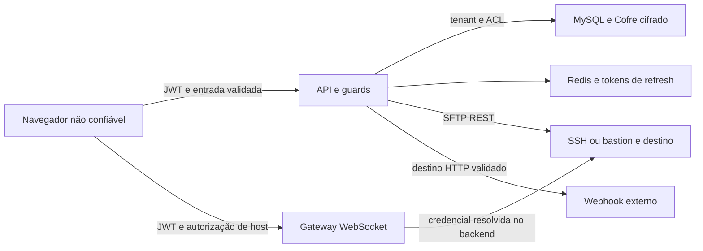

# Diagnóstico inicial — fronteiras e evidências

Base examinada: `e83fdc5bac00c3ef72b19b18169941d2d3f67fc8`, candidato local da Central.
Data: 14/11/2026. Leitura focal; sem pentest, scan ativo, dados reais ou certificação.
Esta rodada inicia o diagnóstico aprofundado, não encerra a auditoria de todos os protocolos.

## Fronteiras de confiança

JWT identifica usuário/tenant, mas cada acesso a recurso precisa preservar autorização no
backend. Redis e banco pertencem à fronteira de serviço; browser e destinos remotos não.
Acesso legítimo a infraestrutura privada via SSH não deve receber automaticamente a política
de destino público dos webhooks. Agentes, MCP, acesso gráfico e gateway nativo precisam de
matrizes próprias na expansão desta investigação; o diagrama não declara cobertura completa.

## Evidências iniciais

| ID | Observação de código | Evidência | Limite / próximo teste |
|---|---|---|---|
| D-01 | Guard REST verifica JWT e stage authenticated; checagem de versão por assertTrialUserAccess só consulta usuário quando há trial | shared/guards.ts:46–59; modules/trials/trial-policy.ts:40–49 | Hipótese: token de acesso previamente emitido pode continuar aceito em tenant normal após logout-all, desativação ou mudança de papel. Reproduzir localmente com JWT válido e estado alterado; verificar hooks adicionais antes de concluir falha. |
| D-02 | Refresh compara sessionVersion; logout-all incrementa versão. Logout comum remove refresh específico | modules/auth/auth.service.ts:364–365, 474–492; auth.service.refresh.test.ts:167 | Testes de refresh não comprovam rejeição imediata de access token nem encerramento de WebSocket. Definir expectativa de produto/TTL e testar os três canais separadamente. |
| D-03 | Cofre lista metadados e resolve valores após filtro de tenant/usuário/grupo e checagem de ativo | modules/secrets/secret.routes.ts:24–77; secret.service.ts:286–310; secret.repository.ts:104,139 | Controle observado, não prova exaustiva de todos os consumidores. Matriz com IDs de outro tenant, grupos removidos, revogação e rotação durante uso; avaliar importações e integrações. |
| D-04 | Webhook valida DNS no socket, rejeita IP privado e redirects, limita prefixo de resposta | shared/ssrf-guard.ts:28–73; shared/webhook-http.ts:6–15; modules/webhooks/webhook-dispatcher.service.ts:145–150 | Controle específico do caminho normal; trial usa outro transporte. Testar ambos e inventariar demais clientes HTTP sem generalizar a proteção. |
| D-05 | Registro de uso de segredo é best-effort e sua falha não bloqueia devolução ao consumidor backend | modules/secrets/secret.service.ts:293–301 | Decisão operacional observada, não bypass de ACL. Confirmar política de auditoria e teste de indisponibilidade sem expor valor em erro/log. |

Caminhos acima relativos a `apps/backend/src/`. Prioridade de investigação não equivale a
severidade confirmada. Nenhuma exploração ou impacto real foi demonstrado nesta leitura.

## Matriz mínima de validação seguinte

| Cenário | Resultado a verificar | Estado |
|---|---|---|
| Token antigo após logout-all/desativação/rebaixamento | REST, nova sessão e sessão existente coerentes com política definida | Planejado; refresh tem testes existentes |
| Tenant A solicita host/secret/session de B | Negação no backend antes de resolver credencial ou abrir conexão | Planejado; inventariar contratos por endpoint |
| Host key ausente/trocada, direto e via bastion | Política explícita e consistente por SSH/SFTP/túnel/gateway | Leitura independente concluída; reprodução pendente |
| ACL/grupo revogado durante sessão | Fechamento/rejeição em cada protocolo e em múltiplas instâncias | Leitura independente concluída; reprodução pendente |
| DNS público vira privado; redirect para loopback | Conexão bloqueada no socket nos dois transportes de webhook | Contratos existentes ssrf-guard.test.ts e webhook-http.test.ts executados na baseline PASS; cenários novos e matriz entre transportes ainda pendentes |
| Falha Redis/DB/auditoria | Comportamento definido por operação; sem fallback que amplie permissões | Planejado |

## Decisões antes de corrigir

Definir prazo esperado de invalidação de access token e sessões existentes; política de host
key inicial/alterada para cada protocolo; e comportamento em falha de dependências. Uma
correção não deve introduzir consulta por byte do terminal nem bloqueio geral de rede privada.
Reusar laboratórios e testes existentes. Novos patches terão plano/risco/testes/rollback próprios.

## Validações desta frente

Ran: leitura de fontes/testes, conferência de base/fronteiras e baseline de cinco suítes/50 testes existentes PASS (refresh, controller auth, Cofre, SSRF e transporte webhook), executada no checkout NA-0172 do mesmo SHA, que contém as dependências. Evidência em `evidence/baseline.json`; log privado canônico `.tmp/NA-0174-diagnosis/existing-contracts.log`. Esses contratos não reproduzem D-01–D-12. Skipped: probes e scans ativos. Revisão documental independente PASS_WITH_WARNINGS, com correções de referências e atualização de validações aplicadas; não é aprovação de segurança do produto.

## Revisão independente — identidade SSH e revogação

Revisor `review_isolation`, somente leitura na mesma base. Nenhum teste/probe executado pelo
revisor. Observações da fonte abaixo não equivalem a exploração ou impacto demonstrado.

| ID | Fato observado e evidência | Hipótese / teste discriminante |
|---|---|---|
| D-06 | Gateway nativo admite em native-ssh-gateway.service.ts:826 e abre sessão gerenciada em :873; não foi encontrado registro do handle no SshSessionRuntimeRegistry. Container injeta registro no WebSocket (container.ts:393) | Abrir SSH nativo descartável, remover connect e verificar fechamento TCP/comando posterior. Comparar com WebSocket; possível sessão selecionada para revogação sem handle local. |
| D-07 | sftp.service.ts:73 constrói config sem hostVerifier/fingerprint, usada no alvo :164 e bastion :182 | Servidor descartável com chave divergente, operação list REST direta/via bastion; observar se autenticação e operação prosseguem. Omissão explícita confirmada, efeito em runtime pendente. |
| D-08 | Bastion tem config separada sem fingerprint em ssh.gateway.ts:717 e tunnel.service.ts:245; tunnel-ssh-connection.ts:15 verifica alvo, :36 usa config original do salto | Trocar só a chave do bastion com alvo correto; verificar autenticação no salto e separar confiança do alvo. mcp-interactive-ssh.service.test.ts:114 espera ausência de hostVerifier no bastion. |
| D-09 | ssh.session.ts:293 distingue propriedade trustedHostKeyFingerprint ausente de null; managed-ssh-session.service.ts:305 conserva distinção. ssh.gateway.ts:712 passa propriedade | Matriz ausente/null/correta/divergente por consumidor. Não há prova de entrada externa capaz de omitir propriedade. Túneis têm testes reais em tunnel-real.test.ts:11,45. |
| D-10 | inventory-acl-session-revocation.service.ts:22 recalcula connect; sessions.repository.ts:335,374 seleciona sessões authenticated. ssh.gateway.ts:1049 registra runtime; JIT tem concessão própria em ssh.gateway.ts:276 | ACL por pasta/membership durante SSH/TELNET/RDP/VNC; verificar transporte e tenant. Não classificar JIT como bypass sem avaliar o contrato de concessão. |
| D-11 | sftp.service.ts:140 verifica ACL na abertura e :291,309 abre conexões próprias para transferências; monitor :168 é trial. tunnel.service.ts:659 fecha por ACL e :337 revalida após abertura | Revogar connect durante transferência longa e túnel ativo. Definir política para trabalho já autorizado; cobrir criação concorrente (tunnel-concurrency.test.ts:159). |
| D-12 | app-event.bus.ts:134 publica Redis; :193 registra falha de handler. session-runtime-control.bus.ts:37 retorna negativo por timeout/erro; :64 aceita primeira resposta inclusive negativa | Duas instâncias: não proprietária responde negativo antes da proprietária. Verificar separadamente fechamento real, estado persistido e auditoria; depois falha Redis. Resposta negativa não prova que sessão permaneceu aberta. |

Referências pertencem aos módulos de SSH, native-ssh-gateway, SFTP, tunnels, inventory,
sessions e infraestrutura do backend. Nomes acima são únicos no escopo inspecionado;
localizar pelo arquivo antes de implementar. Testes citados foram examinados pelo revisor,
não executados como reprodução dos achados.

## Próxima rodada proposta

1. D-07/D-08: reproduzir identidade de alvo/salto em laboratório descartável, sem credenciais reais.
2. D-06/D-12: reproduzir revogação nativa e confirmação distribuída, incluindo erro/timeout.
3. D-01/D-02: validar token antigo em tenant normal e estabelecer expectativa de invalidação.
4. D-03/D-10/D-11: completar matriz tenant/ACL por protocolo e operações em andamento.

Essa ordem prioriza testes pequenos capazes de confirmar ou refutar diferenças concretas.
Severidade, correção e rollout serão definidos depois da reprodução e análise de exposição.

## Ensaio discriminante D-01 — guard isolado

Ran: quatro cenários PASS com Fastify/JWT/guards reais e rota descartável em memória.
Tenant normal com JWT admin assinado e leitor de usuário configurado para rejeitar: HTTP200,
zero consultas ao leitor. Controle trial ativo: HTTP403 e uma consulta; token expirado e
stage mfa_pending: HTTP401. Evidência: evidence/guard-scope.json.

Conclusão limitada: confirmou-se o comportamento do guard de tenant normal, não um bypass
na aplicação completa após logout/desativação. O ensaio não executa essas mutações reais nem
hooks globais; claims foram construídas com chave sintética. Próximo: contrato integrado da
rota real com estado de usuário alterado e expectativa de invalidação definida.
Fontes guard/trial conferidas byte a byte com a base original do diagnóstico; ensaio executado
no checkout da Central no SHA0b68abaf301e72b2fd4820b47876457a5b8915d3. Primeiro ensaio falhou
antes dos testes por caminho de import do harness; corrigido sem modificar produto/assertions.

Revisão independente do ensaio: PASS_WITH_WARNINGS. Caso normal usa requireAdmin (que chama requireAuth); controle trial usa requireAuth. São rotas sintéticas com guards diferentes, não reprodução de mutação administrativa real. Igualdade de fontes verificada pelo executor e hashes preservados na evidência.

## D-13 — Gate de imagens bloqueia integração da Central

CI do SHA0b68abaf301e72b2fd4820b47876457a5b8915d3 reprovou security:images.
Evidências duráveis: evidence/image-gate.json e evidence/image-scan-summary.json.
Não equivale a exploração demonstrada no produto.

| Imagem | Achados bloqueantes | Tratamento necessário |
|---|---|---|
| backend | stdlib go1.26.10 / GO-2026-6859 / Unknown | Identificar binário no inventário e atualizar origem para Go corrigido; scanner indica1.26.11/1.27.4. |
| tls-agent | python3 3.14.10-r1 / CVE-2026-119170 / High | Confirmar exposição, advisory e pacote corrigido; scanner não informa fix. |
| mysql | openssl-libs e gnutls / ELSA-2026-50075,50346,500448 / High | Revalidar três triagens FIPS/epoch expiradas, com pacote/changelog atuais e revisão independente. |
| guacd | cups-libs/CVE-2018-6553 e libssh2/CVE-2026-59850 / High | Revalidar duas triagens de correspondência/aplicabilidade expiradas. |
| guacd | zlib1.3.2-r1 / CVE-2026-4738 / Critical | Validar atualização compatível; Alpine lista1.4-r0 como corrigida. |

As duas políticas expiraram em08/11/2026. Nenhuma exceção foi renovada. A atualização
multicomponente exige tratar regressões de TLS, banco e guacd; não aplicar troca ampla
às cegas nem equiparar resultado do scanner a exploração. Investigar pacote/origem primeiro.

Fontes verificadas: [Alpine](https://security.alpinelinux.org/vuln/CVE-2026-4738)
lista zlib1.4-r0 corrigida, mas descrição refere módulo de GDAL: conferir correspondência.
[Oracle ELSA-2026-500448](https://linux.oracle.com/errata/ELSA-2026-500448.html)
documenta epoch10/sufixoFIPS e a versão regular3.5.8-2.0.1. Isso sustenta investigar falso
positivo, não aprova automaticamente a imagem atual. Fonte Go redirecionada não pôde ser
consultada; versão corrigida acima é informação do scanner, ainda sem verificação independente.

Ordem imediata: resolver D-13 para liberar integração; depois D-07/D-08, D-06/D-12 e
D-01/D-02 em laboratório. Central permanece PR_OPEN/draft, sem merge ou implantação.

Revisão independente D-13: PASS_WITH_WARNINGS documental; contagem8/4 e cinco triagens
vencidas conferidas. Duas ocorrências High adicionais de SQLite têm triagem vigente até18/11
e não entram nos oito bloqueios. Corrigidos caminho da evidência, estado FAIL explícito e
texto da baseline SSRF/webhook. Revisão não aprova integração nem segurança do produto.

## Reproduções autorizadas — 15/11/2026 UTC (14/11 em São Paulo)

Classificação: REPRODUCED_WITH_LIMITATIONS, revisão independente concluída. Não confundir
asserções aprovadas de reprodução com aprovação dos controles.

| Observação | Comportamento reproduzido | Fronteira e limite |
|---|---|---|
| D-01/D-02 | JWT antigo mantém GET /users200 após logout-all/desativação/rebaixamento. Refresh nega os dois primeiros; após rebaixamento emite token que recebe403 na rota admin. | HTTP, login senha/TOTP, serviços, Prisma/MySQL/Redis reais; sem bootstrap/UI completos. Webhook inerte para impedir egress. |
| D-07 | SFTP autentica e lista com fingerprint divergente no alvo direto ou via bastion. ACL negada impede autenticação. | Serviço e SSH/SFTP reais; repositório/tenant sintéticos. |
| D-08 | Bastion sem verifier conecta; verifier explícito rejeita antes da autenticação; alvo divergente de túnel é rejeitado. | Conexão real; configuração equivalente ao builder, sem atravessar todo TunnelService. |
| D-06 | Sessão nativa existente aceita comando após revogação Redis/evento real; novo canal negado. Registry sem handle. | Login bcrypt, gateway, sessão gerenciada, shell e Redis reais; repositórios/ACL sintéticos. |
| D-12 | Oito retornos negativos em dez tentativas apesar de dez sockets encerrados. | Duas instâncias do bus/registry no mesmo processo; erro de confirmação, não sessão demonstradamente aberta. |

Evidências: evidence/auth-http-real.json e evidence/ssh-revocation-real.json. Fontes exercitadas
conferidas contra0b68abaf301e72b2fd4820b47876457a5b8915d3, mesmo com Docker/docs em alteração.
Limpeza dos containers, sockets, volumes e chave efêmera confirmada. Harnesses/logs privados
em .tmp/NA-0174-auth-e2e e .tmp/NA-0174-e2e; não usar dados reais ao reproduzir.

Prioridade de correção proposta: desativação/rebaixamento e identidade SSH; depois fechamento
nativo e confirmação distribuída. Definir contrato de logout-all e janela de invalidação antes
de ampliar política. Não foi aplicado patch de autenticação, SSH ou autorização nesta rodada.
A Central não prometia revogação imediata nem host key universal; permissões passam a partial
para refletir o limite comprovado, sem publicar os detalhes de reprodução na interface.

## Regressão de empacotamento — guacd

SSH e VNC reais via protocoloGuacamole aprovados na imagem89bbbbe3… com zlib1.4-r0.
FrameVNC32x32 comprimido produziu PNG conferido em1024pixels; teclas chegaram aos servidores.
Sem browser, RDP ou teste prolongado. Ver evidence/guacd-real.json. Isso valida a correção
de empacotamento, não elimina os achados de autorização/identidade reproduzidos acima.

## Atualização D-13 — 2026-11-15T13:24:26-03:00

TRATADO E VALIDADO:7/7 imagens PASS no CI do head `8d668889a77708166154113a239034c97e268da6`. MySQL com libbrotli
corrigido por pacote oficial; build novo, stack/TLS, upgrade/restore e Sonar aprovados.
Guacd1.6.0 mantido, bibliotecas corrigidas. Cinco triagens exatas até29/11, SQLite18/11.
PR63 MERGED e MASTER_SYNCED `28685c5b2c3fbf9739a05629260c95e42e0d62d0`. Não houve deploy; RDP/arm64 não homologados.
Demais achados de controles continuam abertos, com as limitações de reprodução registradas.
Evidência: ../NA-0172-security-center/evidence/gate-final-20261115.json.

## Estado dos controles após correções — 2026-11-15

As reproduções acima são históricas e motivaram o candidato ce7a31fda (PR64).
D-01/D-02: estado atual e versão de sessão exigidos; logout-all concorrente por CAS,
com revogação de canais existentes. D-06: gateway nativo registra/revalida o runtime.
D-07/D-08/D-09: identidade SSH obrigatória no alvo e salto em SSH/SFTP/túneis/MCP;
bastion legado exige Host de origem regularizado. D-11: revogação cancela conexões e
transferências pendentes/ativas; arquivos parcialmente escritos não são revertidos.
D-12: ACK correlacionado aguarda proprietário; negativos de outras instâncias não
encerram antecipadamente a espera. Testes distinguem ACK de encerramento real.
D-03/D-04/D-05/D-10: matriz focal tenant/Cofre/SSRF/ACL validada conforme evidence/controls-validation-20261115.json.
D-13: já integrado pela PR63; novo CI de upgrade/restore e scanner7/7 também PASS no ce7a31fda.

Limites: RDP/VNC cobertos por contratos/injeção de transporte, sem wire real nesta rodada;
Redis pubsub não durável; revogação tardia pode alcançar reconexão válida. Não é pentest
completo nem aprovação de produção. Gate Sonar ce7a31fda FAIL (cobertura76,2% e coleta),
correções em andamento; PR64 draft, sem homologação humana/merge/deploy.
