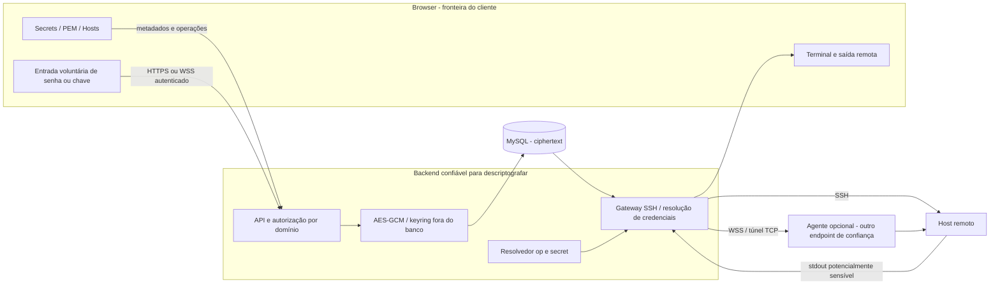
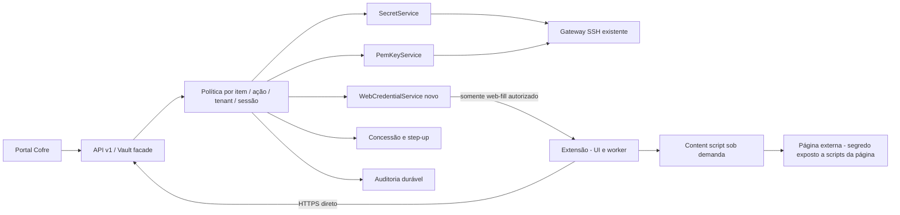
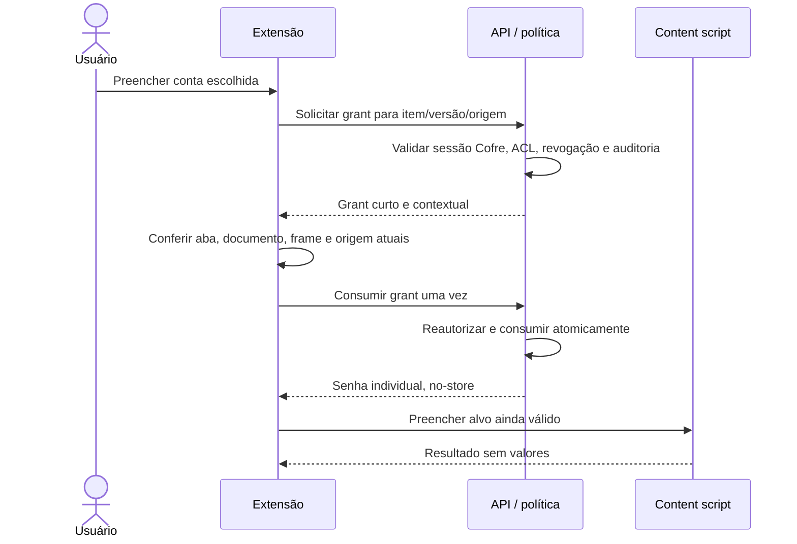

# NA-0175 — Avaliação do VaultNAccess e extensão

> Atualização de produto: [adendo VaultNAccess](vaultnaccess-addendum.md) passa a reger revelação autorizada de senhas, desbloqueio, distribuição e evolução E2EE. O diagnóstico AS-IS permanece válido nos limites da base observada.

> Requisito posterior de não regressão e criptografia por operação: [parecer híbrido](hybrid-delivery-review.md). Prevalece sobre desenhos que coloquem o delivery novo no caminho SSH/RDP.

## 1. Resumo executivo

**GO_WITH_RISKS para planejamento e consolidação incremental; NO_GO para liberar autofill, bridge nativa ou desbloqueio biométrico antes dos respectivos gates.** RFC v4 avaliado, não aprovado automaticamente. Nenhum código, migração, infraestrutura ou recurso de produção alterado.

Recomendo um Cofre como fachada de descoberta e política sobre Secrets e PEM existentes, preservando seus IDs e armazenamento. Depois, extensão de busca/abertura via HTTPS direto; login web e autofill entram em entregas próprias. Agente opcional, WebAuthn e mobile não devem bloquear a primeira entrega visual.

O RFC reúne ao menos cinco problemas diferentes: consolidação do portal, domínio de credenciais web, cliente de extensão, autenticação reforçada e comunicação nativa. Tratar tudo como um MVP aumenta risco, homologação e manutenção. A fase 1 descrita no RFC já inclui relações a URLs e tipos que ainda precisam de modelagem; dividi-la em 1A (existentes) e 1B (novos tipos) é uma proposta de recorte a aprovar.

**Base da análise:** checkout canônico `745253d1edb522db79aaa44fd96608ce434a2774`, branch `feature/NA-0172-20261106-security-center`, com alterações anteriores preservadas. A worktree master está em `28685c5b2c3fbf9739a05629260c95e42e0d62d0`; a NA-0174 está em `15938ada5b1a62e54870bfe50411bbce9f0a4f41`. O registro NA-0174 informa PR64 em homologação; seu guard foi inspecionado diretamente e já chama `assertCurrentUserSession`. Não confundir o checkout antigo com a base da futura implementação. Sem consulta remota de PR nesta análise.

**Limite da evidência:** inspeção estática e consulta a documentação oficial. Não executados testes de aplicação, pentest, PoC de extensão, benchmarks, captura de tráfego ou auditoria exaustiva de exportações/backups. Ausência encontrada em busca não prova ausência universal. Achados de código abaixo não equivalem a exploração demonstrada.

## 2. Evidências da implementação atual

Caminhos abaixo são relativos à raiz; linhas referem-se ao checkout canônico, salvo indicação explícita.

| Componente | Arquivo / função / linha | Comportamento observado e consequência |
|---|---|---|
| Secrets públicos | `apps/backend/src/modules/secrets/secret.service.ts:11`, `toPublic`, `list` | Não serializa valor/IV; escopos PERSONAL/GROUP/TENANT e licença `secrets`; administrador vê itens do tenant, inclusive pessoais. “Pessoal” não significa invisível ao administrador. |
| ACL Secrets | mesmo arquivo, `findAccessibleActiveById`, `ensureCanManage`, `normalizeScopeInput` | Uso por dono/grupo/tenant/admin; gestão por dono/criador de grupo/admin; criação TENANT só admin. Separação parcial de uso/gestão, sem política explícita de fill/reveal. |
| Persistência Secrets | `apps/backend/src/modules/secrets/secret.repository.ts:78`, `findAccessible` | Filtro tenant e ACL no SQL; consulta de listagem ainda carrega ciphertext em memória antes de `toPublic`; não equivale a vazar resposta, mas admite projeção mais restrita. |
| PEM | `apps/backend/src/modules/pem-keys/pem-key.service.ts:11`, `toPublic`, `normalizePemKey` | Resposta contém nome, criador, data e hasPassphrase; importação validada por ssh2, conversão PPK prevista; sem reveal nessa API. |
| Tenant PEM | `apps/backend/src/modules/pem-keys/pem-key.repository.ts:6` | Pertencimento derivado do criador; `findByUser` filtra criador, `findAll/findById` usam tenant do criador. Sem escopos iguais aos Secrets. Testar delegação/transição de tenant antes de unificar política. |
| Criptografia | `apps/backend/src/shared/crypto.ts:4`, `EncryptionKeyring` | AES-256-GCM, IV aleatório, keyring primária/anteriores via `PEM_ENCRYPTION_KEY`; sem DEK por item/KMS/AAD tenant no helper. Não chamar isso de envelope encryption ou E2EE. Gestão operacional das chaves não auditada. |
| Hosts | `apps/backend/prisma/schema.prisma:564`; `apps/backend/src/modules/hosts/host.service.ts:449` | Referências `pemKeyId`, `passwordSecretId`, `onePasswordRef`; ainda há senha cifrada no host. Uso de Secret por ID valida acesso na associação. Não migrar senhas antigas silenciosamente. |
| SSH | `apps/backend/src/modules/ssh/ssh.gateway.ts:362`, `:433`; `ssh.session.ts:321` | Resolve Secret no backend e descriptografa credencial na sessão SSH. Fallback pede entrada de senha ao usuário; essa entrada passa pelo browser/WebSocket. |
| Snippets | `secret.service.ts`, `resolvePlaceholders`; `secret-redactor.ts:1` | Substituição server-side, auditoria mascarada e redaction com TTL de 30 s. Não garante impedir eco arbitrário, transformação do segredo ou vazamento posterior pelo host. |
| 1Password | `apps/backend/src/modules/integrations/onepassword.service.ts:18` | `op://` via SDK/token do tenant; `secret://` consulta alias por tenant sem usuário/ACL de Secret nesse método. Requer teste de acesso indireto. |
| PEM via integração | `apps/backend/src/modules/ssh/ssh.gateway.ts:407` | `encryptedKey: encrypt(secret).encrypted, iv: encrypt(secret).iv`: dois IVs aleatórios; provável falha de descriptografia. Padrão também confirmado na NA-0174, linha 411; não reproduzido nesta rodada. |
| Auditoria/logs | `secret.service.ts`, `pem-key.service.ts`; `apps/backend/src/config/logger.ts:5` | Eventos administrativos sem valores, mas falhas engolidas como best-effort. Redaction tem password/privateKey, mas não cobre explicitamente todos os nomes de entrada `value`, `key`, `passphrase`; falta demonstrar emissão real para afirmar vazamento. |
| Sessão | `apps/backend/src/modules/auth/auth.service.ts:333`, `:474`, `:731`; `tenant-auth-policy.service.ts:49` | JWT access/refresh, refresh em Redis, sessionVersion, MFA/TOTP e políticas de duração de tokens. Isso não implementa sessão de Cofre/inatividade/step-up por ação. |
| Cliente portal | `apps/frontend/src/stores/auth.ts:33` | Access e refresh persistidos em localStorage. Não reutilizar automaticamente esse armazenamento na extensão. |
| URLs existentes | `apps/backend/prisma/schema.prisma:959`, `:987` | HostLink é compartilhamento/token; HostAssociatedLink é URL template ligada a host. Nenhum deles, por si só, representa login web com origem autorizada. |
| UI | `apps/frontend/src/router/index.ts:70`, `:73`; `layouts/AppLayout.vue:408`, `:417` | Duas rotas/telas e menu; Secrets depende de licença. `SecretsView.vue` oferece gestão/rotação/revogação/consumidores; `PemKeysView.vue` importação/passphrase/exclusão. |
| Agente | `apps/agent/src/index.js:194`, `:312`; `connection-security.js:2` | `/ws/agent`, frames TCP, destino sob política; WSS com validação de certificado fora de modo development explícito, bearer no header. Não é mTLS nem prova de identidade de hardware. |
| Identidade agente | `apps/backend/src/modules/agents/agent.service.ts:399`, `:488`, `:587`, `:638`; `agent.gateway.ts:93` | Token retornado uma vez, hash persistido, rotação/revogação e revalidação periódica (5 s). Não prometer revogação instantânea ou autenticação do usuário do browser. |
| Plataformas | `apps/agent/installer/platforms.mjs:2`; `agent.routes.ts:25` | Alvos Windows/Linux/macOS x64; MSI Windows. Build instalado/assinatura/hardware/arm64 não homologados aqui. Busca `nativeMessaging/connectNative/allowed_origins/webauthn` em apps/packages sem resultados. |

## 3. Mapa AS-IS



O segredo armazenado não é devolvido pelas APIs de listagem examinadas. A frase “nunca chega ao navegador” deve limitar-se ao material usado na autenticação intermediada: cadastro, senha ad hoc e stdout remoto são exceções concretas. RDP/VNC e todos os caminhos de exportação exigem verificação própria; não extrapolar a análise SSH.

## 4. GAP analysis priorizada

Prioridades são de investigação/gate técnico, não novas prioridades do roadmap. Nenhuma vulnerabilidade P0 foi reproduzida nesta avaliação.

| ID | Gravidade | Lacuna / evidência | Gate proposto |
|---|---|---|---|
| G01 | P1 | `secret://` contorna o resolvedor com ACL por usuário; `onePasswordRef` é string no schema de host. Caminho persiste no candidato NA-0174. | Testar usuário autorizado ao host, mas não ao Secret de outro usuário/grupo do mesmo tenant. Decidir explicitamente autorização por delegação do host versus ACL própria; não oferecer esse caminho à extensão. |
| G02 | P1 | Dois `encrypt` no carregamento de PEM da integração combinam ciphertext/IV distintos. | Regressão usando chave sintética; usar uma única operação de cifragem em correção separadamente autorizada. |
| G03 | P1 | Sessão de Cofre/step-up/revogação por concessão ainda não identificados. NA-0174 resolve parte da validade de sessão geral. | Partir da base integrada mais recente e provar invalidação de concessões/tenant/permissão a cada uso; não duplicar correções da NA-0174. |
| G04 | P1 | API de listagem não pode virar endpoint genérico de reveal; autofill muda a fronteira de exposição. | Tipagem WEB_LOGIN e ação web-fill específica; nenhum fill de PEM/Secret operacional por conversão automática. |
| G05 | P1 | Auditoria best-effort e cobertura de redaction incompleta para nomes novos. | Decidir falha fechada para entrega sensível e/ou outbox transacional; canários sintéticos em erro, logs, traces e auditoria. |
| G06 | P1 | Token do agente não vincula usuário/perfil da extensão; ponte inexistente. | PoC isolada, pareamento e capacidades mínimas antes de qualquer canal nativo. |
| G07 | P1 | Isolamento/compartilhamento dos tipos divergente; grupo do host não concede automaticamente acesso ao segredo. | Matriz negativa de ambas as ACLs, associações N:N e usuários multi-tenant/delegados. |
| G08 | P2 | Falta domínio de credencial web, origens, concorrência e URL sem host. | Modelagem aditiva e versionamento; normalização de origem exata. |
| G09 | P2 | Listagens existentes sem paginação unificada; cache e worker suspenso. | Paginação autorizada no servidor; TTL apenas metadados e invalidação por identidade/tenant. |
| G10 | P2 | Import PEM sem limite específico de tamanho no schema compartilhado; algoritmos não expressos como política de produto. | Definir limites de payload e matriz RSA/Ed25519/ECDSA/PPK/passphrase suportada, recusando entradas inválidas. |
| G11 | P2 | Criptografia não vincula ciphertext a tenant/item via AAD; chave mestra comum aumenta impacto de comprometimento. | Threat model e ADR de key lifecycle/KMS separado; não exigir recriptografia para consolidar UI. |
| G12 | P3 | Rotas/menu duplicados e microcopy podem confundir usar/revelar/rotacionar. | Cofre único com ações específicas e compatibilidade legada. |

## 5. Arquiteturas alternativas e decisão recomendada

| Opção | Ganhos | Custo / riscos / migração |
|---|---|---|
| A — fachada incremental no monólito | Reaproveita SecretService/PemKeyService, schemas, auditoria e consumidores; entrega rápida da UI | Adaptadores tipados, políticas heterogêneas visíveis; não fingir que todos suportam compartilhar/rotacionar/revelar. Sem migração na 1A. |
| B — módulo dedicado de Cofre no mesmo backend | Modelo único de itens, grants, versões e ciclos de vida; melhor expansão futura | Backfill, compatibilidade de IDs, conciliação de permissões, possível duplicação transitória e maior superfície de regressão. Não precisa virar microserviço. |

**Recomendação A com evolução seletiva:** criar políticas e contratos comuns apenas onde houver necessidade; novos tipos podem ter tabelas próprias. Não criar tabela universal de segredos nem migrar PEM/senhas antigas para começar. Reavaliar B quando a complexidade real de associações/políticas justificar seu custo. Custos relativos: A médio, B alto; sem prazo ou equipe presumidos.

## 6. Modelo TO-BE



Projeção `VaultItemSummary`: identificador composto `(kind, sourceId)`, tenant, rótulo, tipo, estado, escopo e operações permitidas. IDs numéricos de PEM e Secret podem colidir; nunca usar apenas `id`. Capabilities são orientação de UI; servidor sempre reautoriza.

Novos dados, somente após ADR: `WebCredential` (tenant, dono/escopo, título, username, referência cifrada, versão, revogação); `WebCredentialOrigin` (scheme/hostname/port normalizados, política); `ResourceAssociation` N:N por tipo e tenant; `ResourceLink` para URL sem senha/host. Preferir referências explícitas com integridade verificável a FKs polimórficas sem validação. Não colocar senha em `HostAssociatedLink.urlTemplate`.

`VaultSession`: usuário, tenant, sessão de origem, perfil/dispositivo lógico, issuedAt, lastRelevantActivityAt, absoluteExpiresAt, lockedAt/revokedAt e nível de autenticação. Armazenamento e consistência a decidir. Refresh da sessão principal não reinicia relógio absoluto do Cofre. Grant de ação vincula item/versão/ação/origem/contexto e expira/consome atomicamente; browser não pode declarar seu próprio nível de autenticação.

APIs novas são propostas sob `/api/v1`, preservando convenções atuais: `GET /vault/items` (metadados autorizados/paginados), cadastro tipado delegado aos serviços existentes, `POST /vault/web-credentials/:id/fill-grants` e consumo de grant; `POST /vault/session/lock` e fluxo de reautenticação. Campos como tenant efetivo vêm da sessão validada. Não criar `/use` que devolva qualquer tipo de segredo. Abrir host usa navegação identificada por ID e reautoriza no fluxo de sessão existente; não gerar link público/compartilhado como atalho.



O servidor não atesta o DOM nem a autenticidade da aba informado por uma extensão comprometida. Vincular contexto reduz confusão/replay, mas não elimina esse limite. Nenhuma promessa de apagar strings de memória com garantia.

## 7. Threat model

Ativos: valores secretos, chaves mestras, tokens, metadados corporativos, grants e trilha de auditoria. Atores: usuário legítimo, usuário de outro tenant/grupo, página maliciosa, extensão/processo local comprometido, agente comprometido e administrador do backend. Fronteiras: página/content script; UI/worker; browser/API; API/banco; worker/bridge/agente; gateway/host; tenant/tenant.

| Ameaça | Prioridade e mitigação | Risco residual |
|---|---|---|
| IDOR, tenant errado, associação ampliando acesso | P1: filtros antes de listar/contar, checar ambos os lados, negar existência quando necessário | Administrador autorizado e backend continuam dentro da confiança |
| Phishing, redirect, troca de aba/frame após autorização | P1: origem HTTPS exata; frame principal inicialmente; revalidar documentId/tab/frame antes da entrega; cancelar navegação | Site legítimo comprometido lê senha após fill |
| Mensagens falsificadas | P1: sender/tab/frame/documento validados pelo worker, schemas fechados, nenhuma execução arbitrária | Extensão comprometida controla seu próprio código |
| Replay / corrida de grants e edições | P1: nonce, TTL, consumo atômico, versão do item, idempotência de cadastro | Senha real continua reutilizável no site |
| Roubo de token / lock apenas visual | P1: sessão própria, escopo mínimo, reautenticação verificável e revogação server-side | Comprometimento total do endpoint não é resolvido por popup bloqueado |
| Supply chain / atualização de extensão ou bridge | P1: pacote sem scripts remotos, revisão, canal de publicação controlado, kill switch | Processo de loja/assinatura precisa operação contínua |
| Logs, snapshots, backups e telemetria | P1: allowlist de campos, canários, sem segredo/URL sensível em métricas; backup cifrado com restore validado | Backups e administradores de chave não auditados nesta etapa |
| MITM / DNS rebinding local / downgrade | P1: TLS validado, Native Messaging preferível a loopback; pareamento e negação de fallback privilegiado | Malware local privilegiado exige tratamento de risco próprio |
| Persistência offline e dados entre perfis | P1: sem segredo persistente; limpar metadados em lock/logout/troca tenant; cancelar requests pendentes | Revogação não apaga algo que uma página já recebeu |
| Abuso de busca/cadastro, payload grande | P2: limites, paginação, quotas, rate limit e auditoria sem valores | Metas de desempenho ainda não medidas |

## 8. UX/UI mínima e estados

```text
Cofre                         [Empresa atual] [+ Novo item]
[Pesquisar...] [Tipo: Todos] [Escopo] [Estado]
Nome             Tipo        Escopo       Estado       Ações
db-prod          Secret      Grupo A      Ativo        ...
ssh-operacao     SSH/PEM      Criador      Em uso       ...
Detalhe: metadados / relações autorizadas / ações por tipo
```

Novo item → tipo → campos específicos → escopo permitido → associação opcional autorizada → confirmar → metadados na lista. Edição de segredo é substituição explícita, sem carregar valor salvo. Retorno Host → Cofre → Host preserva contexto de navegação validado, nunca URL de retorno externa arbitrária.

| Estado | UX e regra |
|---|---|
| Carregando | Skeleton curto, cancelar busca anterior, manter foco |
| Sucesso | Nome/tipo/escopo e confirmação; nunca ecoar valor |
| Vazio | Distinguir sem itens, filtro sem resultado e tipo não licenciado |
| Sem permissão | Ações coerentes, erro genérico para item inacessível; não listar item secreto para “solicitar acesso” |
| Sessão expirada / bloqueado | Reautenticar; limpar valor digitado, preservar apenas intenção não sensível |
| Offline | Sem fill, sem fila de segredos ou rascunho persistente; ação tentar novamente |
| Erro / conflito | Informar falha; preservar entrada apenas em memória enquanto apropriado; versão em conflito exige revisão |
| Revogado / em uso | Exibir estado autorizado; bloquear uso; exclusão explica dependências sem revelar recursos sem ACL |

Popup pode fechar e perder estado: importação/edição longa deve usar página dedicada da extensão ou painel compatível, com retorno claro. Não prometer mesmo side panel em todos os navegadores. Teclado, foco após modal/erro, aria-live discreto, zoom e contraste entram no aceite.

## 9. Backlog por fases

Esforço relativo: P pequeno, M médio, G grande, GG muito grande; não são estimativas de calendário.

| Fase | Escopo e dependência | Esforço | Critério de saída / rollback |
|---|---|---|---|
| 0 | Esta avaliação; aprovar ADRs e base de integração | M | Evidências/limites registrados, perguntas decididas; rollback só documental |
| 0A | Reconciliar NA-0174; validar G01/G02 e fechar política de exposição | M–G | Cenários negativos e positivos reproduzidos; correções em escopo aprovado, Sonar e revisão independente |
| 1A | Uma entrada Cofre; Secrets/PEM existentes, filtros, formulários atuais e rotas legadas | M | Mesmos IDs/ACL/licenças/dados, nenhum segredo em listagem; feature flag restaura telas antigas |
| 1B | URL sem segredo, login web, origens, associações e edição versionada no portal | G | Migração aditiva, conflitos/ACL/deduplicação testados; desligar novos tipos mantendo dados |
| 2 | Extensão de descoberta, auth própria, busca/abrir/recente, sem segredo | G | Logout/lock/tenant corretos, mínimos privilégios, navegador-alvo homologado; revogar cliente/flag |
| 3A | Sessão de Cofre e step-up; WebAuthn se aprovado | G | Servidor impõe timeout/inatividade/grants, fallback aprovado e PoCs; desligar operações dependentes |
| 3B | Click-to-fill piloto após 1B/2/3A | GG | Casos adversariais, pentest, compatibilidade e kill switch comprovados; bloquear entrega no backend |
| 4 | Cadastro/edição/import PEM na extensão reutilizando backend | G | Mesma ACL/validação/auditoria; nenhum rascunho secreto persistido; flag de escrita independente |
| Opcional A | Bridge nativa somente se PoC comprovar benefício | GG | Pareamento/perfis/ACL/rotação/tamper e três SOs validados; HTTPS só para operações elegíveis |
| Futuro | Aprovação móvel: apenas ADR agora | P desenho / implementação não estimada | Nenhum app/push/challenge mobile ativo nesta frente |

A extensão pode ser desenvolvida após 1A para buscar hosts/links existentes; login web requer 1B. Cadastro manual web na extensão pode ser antecipado antes do autofill, com aprovação do recorte; não precisa detectar submissão de formulários para ser útil.

## 10. Impacto, migração e rollback

UI: router, AppLayout, locales, SecretsView/PemKeysView, services e links dos consumidores. Backend: fachada/catalogação e políticas; serviços atuais permanecem autoridade. Shared: união discriminada e contratos novos, sem misturar payload público com entrada secreta. Auth/agente/SSH só mudam nas fases autorizadas correspondentes.

Mapear consumidores por ID e alias: hosts, bastions, snippets, integração `secret://` e importadores. Renomear alias pode afetar placeholders; não oferecer “rename genérico” sem contrato de referências. PEM permite passphrase/exclusão hoje, não edição arbitrária/rotação/revogação equivalentes a Secret.

1A não exige migração. 1B usa tabelas/colunas aditivas e backfill opcional idempotente com inventário; comparação de IDs, contagens, relações e uso antes/depois, sem exportar valores. Rollback de código não deve apagar novos logins/associações. Kill switch de autofill bloqueia concessão e consumo, invalida grants e sessões pertinentes; não recolhe senhas já preenchidas. Migração criptográfica requer plano próprio de backup/restore/rotação.

Manual: AppLayout consta em `docs/manual/manifest.json`; implementação futura aplica a skill nodeaccess-manual e revalida capítulos/capturas afetados. Nenhum procedimento mudou nesta análise.

## 11. Perguntas bloqueantes, hipóteses e ADRs

| ADR | Decisão proposta, ainda não aprovada | Quando bloqueia |
|---|---|---|
| 01 — recorte | Aprovar 1A apenas Secrets/PEM, deixando novos tipos em 1B | Antes de código |
| 02 — autoridade | Preservar escopos atuais; administrador pode ver metadados pessoais; definir delegação host→credencial | Antes de ampliar relações e corrigir G01 |
| 03 — exposição | Só WEB_LOGIN pode fill; revelar senhas exige permissão própria conforme adendo; PEM sem exportação por padrão; HTTP negado inicialmente | Antes de 1B/3B |
| 04 — cliente de extensão | HTTPS direto; sessão própria, sem copiar tokens persistidos do portal; estudar OAuth/PKCE ou handoff de uso único | Antes de 2 |
| 05 — plataformas | Proposta Chrome/Edge primeiro; Firefox em gate próprio, versões e SOs a definir | Antes de estimar/homologar extensão |
| 06 — sessão | Separar SSO, unlock e grant; 10 min/8 h do RFC são candidatos, não defaults aprovados | Antes de 3A |
| 07 — auditoria/chaves | Política de falha de auditoria, retenção, acesso aos logs e rotação/restore | Antes de entrega sensível |
| 08 — agente | Sem dependência no MVP; bridge exige benefício demonstrado e identidade por usuário/perfil | Antes de opcional A |
| 09 — biometria/mobile | WebAuthn em origem portal por PoC; mobile só interface conceitual | Antes de 3A e projeto mobile |

Outras perguntas: existe necessidade real de HTTP interno? Quais aplicações/contas entram no piloto? Permite autofill com senha compartilhada sem direito de reveal, ciente de que o usuário/página pode recuperá-la após preencher? Quem opera publicação/rotação do cliente de extensão? Quais eventos podem registrar hostname/username e por quanto tempo? Não atribuir prazos, responsáveis ou políticas por suposição.

## 12. Plano de validação

**Executado:** inspeção de fontes, Git local, cruzamento com planos/registro NA-0174, leitura focal do candidato e referências oficiais. **Não executado:** suítes runtime/Sonar, testes reais, PoCs e medições. Documentação não constitui aprovação técnica de uma implementação.

Testes planejados: contrato de DTO sem valores; matriz usuário/dono/grupo/admin/tenant/delegação; listagem/contagem/consumidores sem vazamento; tentativa `secret://` sem ACL; roundtrip PEM externo; corrida revogar×consumir e editar×fill; logout/refresh/sessionVersion; mudança de tenant/perfil; IDN/punycode, portas, redirect e documento trocado; HTTP, iframe terceiro, campos ocultos e reset de senha negados; worker suspenso; nenhum segredo em logs/storage/cache/clipboard/URL; importação inválida/grande/passphrase incorreta; erro de auditoria e banco; restauração e compatibilidade legada.

Há testes existentes `secret.service.test.ts`, `secret.repository.test.ts`, `secret-ssh.integration.test.ts`, `pem-key.service.test.ts`, `crypto.test.ts`, `agent-security.test.ts` e contratos de hosts. Eles foram localizados, não executados nem considerados cobertura suficiente do RFC.

Performance: medir P95 com tamanho de amostra, browser/versão, hardware, rede e cache declarados. Metas do RFC (popup 300 ms, busca cache 100 ms, remota 500 ms, reconhecimento 200 ms, fill 700 ms após autorização) são hipóteses a validar, sem custo de reautenticação escondido. Inventário de 10k+, WAN/VPN, cold start e várias abas. Não baixar cofre inteiro para atingir meta.

Gates de código: testes pertinentes, `npm run validate:sonar` completo e revisão independente; servidor/token ausente é bloqueio. Se layout afetar área útil do terminal, `npm run test:terminal-experience:web`; se transporte/resize/WS mudar, também `npm run test:terminal-pty:real` em host descartável. Manual após validação; homologação humana e publicação separadas. Checklist de lançamento: flags/kill switch, scopes/manifest revistos, privacidade, atualização/revogação do cliente, observabilidade sem segredos, critérios de piloto e rollback exercitado.

## 13. Jornada equivalente aos fluxos úteis de 1Password

Comparação funcional com a intenção do RFC, sem afirmar paridade com produto/versão atual do 1Password: cadastrar → associar origem/empresa → localizar → escolher conta → preencher conscientemente → substituir valor quando necessário. Busca e abertura primeiro; autofill não automático; governança de massa no portal.

| Contexto de homologação | Comportamento esperado | Estado |
|---|---|---|
| Chrome e Edge, nativo ligado/desligado | Popup manual; não alterar autocomplete nem desativar gerenciador | Planejado |
| Chrome/Edge com gerenciador terceiro | Sem menu inline por padrão; usuário escolhe ação | Planejado |
| Firefox com nativo e terceiro | Mesmo contrato, implementação de background/permissões validada separadamente | Planejado |
| SPA, login em etapas, shadow DOM | Revalidar documento/campo; negar contexto não suportado | Planejado |
| Iframe terceiro, HTTP, reset/alteração de senha | Negar fill no MVP e explicar sem revelar valores | Planejado |

Não prometer ausência universal de conflito com prompts nativos nem detecção perfeita de login. Salvar manual por domínio confirmado é menor escopo que capturar senha do formulário. Medir sucesso, cliques, erros, acessibilidade e prompt fatigue usando eventos sem conteúdo sensível.

## 14. Matriz de formulários e APIs reutilizados

Rotas existentes abaixo sob `/api/v1`; contratos compartilhados em `packages/shared/src/schemas`.

| Tipo | Portal existente | Extensão proposta / lacuna |
|---|---|---|
| Secret | `secret.schema.ts`: alias/value/description/scope/group; GET/POST/PATCH `/secrets`, POST rotate/revoke, DELETE e GET consumers | Reusar serviço/DTO; edição de metadados separada de substituição do valor; sem fill arbitrário |
| SSH/PEM | `pem-key.schema.ts`: name/key/passphrase; GET/POST `/pem-keys`, PATCH `/:id/passphrase`, DELETE | Importação consciente sem retorno da chave; limites/algoritmos a formalizar; sem inventar rename/rotacionar/revogar existentes |
| Senha de host | `host.schema.ts`, password/passwordSecretId/pemKeyId/onePasswordRef | Reusar referências e validação; não fabricar valor a partir de host metadata; ACL do host e item independentes |
| URL ligada a host | `HostAssociatedLink`: label/urlTemplate/openMode | Reaproveitar gestão de links após validar consumidores; template não é origem segura para autofill |
| URL sem host | Sem entidade dedicada identificada nessa inspeção | Novo contrato de link/origem e escopo, zero senha |
| Login web | Não identificado como domínio atual | Novo schema discriminado, username, replacementPassword, origens HTTPS, associações e expectedVersion; GET só metadados |

Criar/editar não pode escolher tenant arbitrário no body; idempotência evita duplicar após retry; optimistic concurrency impede sobrescrever versão mais nova. Duplicidade de URL não implica duplicidade de conta; conta/origem/escopo permitem vários itens. Não reutilizar componente Vue do portal à força no bundle da extensão: compartilhar schemas e regras backend, componentes apenas se comprovadamente úteis.

## 15. ADR para aprovação móvel futura

Proposta conceitual: `AuthorizationChallenge` separado de login, com usuário/tenant/sessão/item/ação/versão, nonce, finalidade, expiração, tentativas e estado. CREATED → AWAITING_USER → APPROVED/DENIED/EXPIRED/CANCELLED; APPROVED → CONSUMED atomicamente. DELIVERED é sinal de entrega, nunca prova de aprovação. Novas políticas invalidam grants/desafios antigos conforme versão.

WebAuthn com user verification e verificação de RP/origin/challenge no servidor é candidato preferencial para resistência a phishing. Mobile com push é notificação; resposta exige dispositivo pareado, prova vinculada à operação e transferência de código, com rate limit e recuperação. Não tratar OOB como phishing-resistant nem simples comparação de números como suficiente. Referência: [NIST SP 800-63B-4](https://pages.nist.gov/800-63-4/sp800-63b.html).

Nenhum app, push token, endpoint inativo ou tabela de mobile agora. Contratos de fatores podem permitir evolução, sem implementar todos os provedores. Aprovação de política por outra pessoa não se confunde com o próprio usuário reautenticando.

## 16. Matriz de conectividade com e sem agente

| Modo | Canal e identidade | Revogação/fallback/operação |
|---|---|---|
| Sem agente — recomendado inicialmente | Extensão→HTTPS API, certificado/hostname válidos; cliente próprio e menor escopo | Mesmas ACLs e sessão Cofre; sem offline de segredo; login/handoff a projetar |
| Agente atual | Outbound WSS, TLS servidor + bearer do agente; TCP para destinos autorizados | Rotação/revogação existentes; não oferece canal autenticado para extensão nem identidade mútua por certificado |
| Bridge futura | Worker→Native Messaging→bridge mínima→API/agente; allowlist de extension ID, pareamento por usuário/perfil, capacidades e mensagens versionadas | Reparear em mudança de usuário, expirar vínculo e revogar ambos os lados; agente não herda toda a autoridade do usuário |
| Loopback alternativo | Somente se Native Messaging inviável; bind loopback, autenticação forte, origem, anti-rebinding/CSRF/replay | Nova superfície e revisão obrigatória; não abrir endpoint genérico de shell/filesystem |
| Agente ausente/antigo/cai | Reavaliar elegibilidade HTTPS; cancelar operação em trânsito e grants | Não repetir automaticamente escrita/fill nem reduzir MFA/ACL; mostrar estado discreto |

Native Messaging usa host registrado e stdio; isso não acrescenta, por si, criptografia de aplicação ou confiança no processo local. [Documentação Chrome](https://developer.chrome.com/docs/extensions/develop/concepts/native-messaging). Precisaria de instalador/allowlist por navegador/SO, atualização autenticada, permissões locais e matriz de perfis. Não manter tokens/PEM privados embutidos no pacote; DPoP/mTLS via endpoint gerenciado apenas com justificativa e suporte demonstrados. TLS 1.3 preferencial/1.2 seguro é proposta operacional; configuração real de todos os ambientes não auditada.

## 17. Matriz de desbloqueio e reautenticação

| SO / navegadores candidatos | PoC necessária | Fallback proposto |
|---|---|---|
| Windows / Chrome, Edge; Firefox separado | WebAuthn no domínio portal com Hello quando disponível; challenge ligado à sessão da extensão | Login corporativo + MFA aprovado ou FIDO2 |
| macOS / Chrome, Edge, Firefox | Touch ID/passkey conforme navegador/hardware; não inferir arm64 a partir do agente x64 | FIDO2 / login corporativo + MFA |
| Linux / Chrome, Edge, Firefox | FIDO2 externo e WebAuthn; nenhum equivalente universal a Hello presumido | Login corporativo + MFA; sem PAM/fprintd genérico no JS |

Todas as células são **planejadas, não validadas**. Realizar PoC em versões/hardware definidos, perfil novo, cancelamento, falha, autenticador ausente, UV obrigatório, RP incorreto, replay e troca de tenant. Preferir cerimônia na origem HTTPS NodeAccess e retorno correlacionado de uso único; origem da extensão não pode assumir arbitrariamente RP do portal. Não capturar PIN/biometria no JavaScript.

Estado server-side distingue sessão autenticada, Cofre bloqueado/desbloqueado e grant privilegiado. Somente atividade pertinente atualiza inatividade; polling não mantém desbloqueado. Expiração absoluta não desliza com refresh. Lock/reinício/troca de tenant cancela solicitações e exige política novamente. Detecção universal de lock do SO sem agente não foi demonstrada; sinal local é adicional, TTL servidor permanece obrigatório.

Não persistir senha, PEM nem refresh bearer sensível em storage local/sync. `storage.session` é opção de estado efêmero a avaliar, não cofre offline nem substituto de revogação. [Chrome Storage](https://developer.chrome.com/docs/extensions/reference/api/storage). Permissões precisam de matriz própria por navegador; `activeTab`/injeção sob demanda devem ser avaliados para evitar acesso permanente a todos os sites. [MDN permissions](https://developer.mozilla.org/en-US/docs/Mozilla/Add-ons/WebExtensions/manifest.json/permissions).

## 18. Plano de consolidação Secrets + Chaves PEM

Inventário confirmado: rotas `secrets` e `pem-keys`; entradas separadas em AppLayout; views e services próprios; schemas compartilhados; consumidores hosts/bastions/snippets/integrações. Antes de alterar, completar busca de todos os links por route name, testes, manual e importadores na base integrada; inventário estático desta avaliação não certifica todos os consumidores.

Destino proposto `/vault`: lista única com filtros de tipo; `/secrets` → `/vault?type=secret`, `/pem-keys` → `/vault?type=ssh-key`, preservando contexto seguro. API antiga permanece; não redirecionar POSTs nem alterar IDs. Filtro não pode ampliar licença: tenant sem Secrets continua vendo PEM permitido, sem vazamento de contagens de Secrets.

| Operação | Secret atual | PEM atual | Regra Cofre |
|---|---|---|---|
| Listar | ACL pessoal/grupo/tenant/admin + licença | Dono; admin tenant | Mesma autorização de origem; ID composto |
| Criar | Escopo validado, TENANT admin | Criador autenticado | Formulários tipados; sem seletor de grupo fictício para PEM |
| Alterar | Metadados; rotacionar valor | Passphrase | Apenas capacidades existentes na 1A |
| Revogar | Disponível | Não identificada equivalente | Não exibir ação universal enganosa |
| Excluir | Bloqueia consumidores host/snippet | Bloqueia host/bastion | Confirmar impacto e checar uso novamente no backend |
| Associar | Host por passwordSecretId; snippet por alias | Host/bastion | Autorizar recurso e item; novas URLs em 1B |
| Revelar / preencher | Não disponível na API examinada | Não disponível | Sem adicionar exposição na 1A |

Aceite da 1A: uma entrada de menu, todos os itens autorizados acessíveis, nenhuma mudança em ciphertext/IDs/relações, links antigos funcionais, ações/tipos/licenças corretos, erro parcial de uma fonte não apresentado como lista completa, teclado/mobile/zoom testados. Comparar metadados e consumidores antes/depois, testar abertura de host/snippet/bastion com fixtures. Rollback por flag volta à navegação anterior sem escrita de dados. Arquitetura de tela pequena com adaptadores/formulários por tipo; não juntar duas páginas extensas num componente monolítico.
