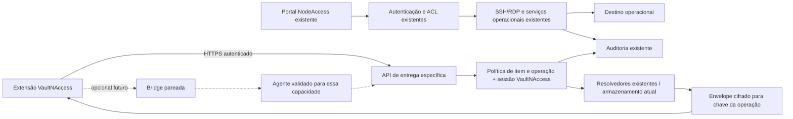

# VaultNAccess — parecer sobre entrega criptográfica híbrida

## Decisão e precedência

GO_WITH_RISKS para incorporar o desenho ao planejamento. O usuário exige preservar autenticação centralizada, SSH/RDP intermediados, uso de credenciais pelo backend e auditoria; a camada criptográfica nova é específica das entregas à extensão. Isso é requisito de produto confirmado. HPKE, ciphersuite, biblioteca, política de dispositivo e endpoints permanecem propostas a validar, sem autorização inferida para implementar ou publicar.

Este parecer complementa o [adendo de produto](vaultnaccess-addendum.md) e prevalece quando o desenho sugerir dependência nova do gateway. Mantidos VaultNAccess, revelação autorizada no portal/extensão e distribuição piloto via frontend. E2EE real não é requisito geral do MVP.

## O que aceitar e o que corrigir

| Proposta recebida | Parecer |
|---|---|
| Arquitetura híbrida, backend como autoridade | Aceitar; criptografia de aplicação adicional não muda quem pode conhecer o segredo no backend. |
| Serviço de entrega comum também no caminho SSH/RDP | Ajustar: não inserir novo serviço na cadeia operacional existente. Reutilizar serviços/autorização onde possível, sem fazer gateway depender de unlock, bridge, dispositivo ou HPKE. |
| HTTPS/TLS 1.3 | Preferência para a extensão, a demonstrar no ambiente. `docker/nginx.prod.conf:67` e `docker/nginx.https.conf:75` configuram TLSv1.2/TLSv1.3. Não alterar política global nem quebrar consumidores atuais para lançar extensão. |
| HPKE por operação | Bom candidato para PoC, sem biblioteca já selecionada. Busca nominal por HPKE nos manifests raiz/backend/frontend/shared não encontrou dependência; não é inventário transitivo completo. |
| Agente com identidade atestada/chaves protegidas | Tratar como futuro. Hoje: WSS com certificado validado e bearer, hash/rotação/revogação do token; isso não comprova TPM, attestation, integridade do SO ou chave não exportável. |
| WebAuthn + WebCrypto | Separar funções: WebAuthn autentica uma cerimônia; chave de entrega cifra/decifra payload. Uma passkey não é automaticamente uma chave genérica de descriptografia HPKE. |
| Perfis Operacional/Corporativo/Privilegiado | Aceitar como presets propostos, somente para funções VaultNAccess; tempos e requisitos a aprovar. Não trocar MFA/sessões centrais nem relaxar ACL via preset. |
| Rotação/revogação de dispositivo somente em etapa tardia | Registro mínimo, vínculo, revogação e expiração precisam existir desde a primeira entrega que dependa da chave registrada; hardware/attestation/gestão avançada podem vir depois. |
| E2EE por categoria no futuro | Aceitar como frente separada, com compartilhamento/recuperação/administração explícitos; sem migrar chaves SSH por consequência. |
| “Proteção de ponta a ponta no transporte” | Preferir linguagem precisa: TLS e entrega cifrada por operação; evitar confusão com servidor incapaz de descriptografar. |

## Arquitetura que preserva os fluxos atuais

A figura não cria um Policy Engine/KMS novo por obrigação. A inspeção anterior encontrou serviços por domínio e keyring AES-GCM; KMS é evolução a avaliar, não componente já disponível. A bridge futura transporta capacidades explícitas, sem transformar o túnel TCP em proxy genérico da API ou expor token do agente à extensão.

Requisitos de não regressão:

- Login central e conexões existentes funcionam com extensão ausente, bloqueada, revogada, desinstalada ou incompatível.
- Falha de HPKE/WebAuthn/bridge/dispositivo impede somente a operação nova que exige esse controle; não derruba sessões SSH/RDP nem muda o fluxo de credencial server-side.
- Bloquear VaultNAccess não é logout global. Logout global/revogação central legítimos devem continuar invalidando acesso, inclusive da extensão; isolamento não pode contornar revogação central.
- Nenhuma chamada obrigatória ao delivery/bridge na abertura operacional, handshake SSH/RDP ou tráfego de sessão. Preservar auditoria atual; eventos de extensão usam o mecanismo existente sem mudar suas regras globalmente.
- Revelação sensível exige auditoria durável segundo ADR; falha dessa escrita nega a nova entrega. Não aproveitar o projeto para modificar silenciosamente o comportamento histórico de auditoria de SSH/RDP.
- Não fundir tabelas/recriptografar valores nem alterar todos os guards, sessões ou políticas TLS para introduzir o cliente de extensão.
- Falha isolada não basta: quotas, limites de payload, concorrência, timeouts e cancelamento devem impedir que carga da extensão esgote CPU, pool de banco, Redis ou auditoria compartilhados. Módulo no mesmo processo ainda compartilha recursos; não prometer isolamento físico sem medições.
- Flags independentes para descoberta, reveal, fill e bridge. Kill switch do delivery bloqueia futuras entregas/grants, mantendo uso backend autorizado. Não faz downgrade silencioso para senha em claro numa rota alternativa.

Portal e extensão compartilham regras de negócio e auditoria, mas não sessão/tokens indiscriminadamente. A revelação no portal também requer sessão de Cofre e grant; não depende da instalação da extensão. Envelope adicional para o portal exige ADR separado se escolhido, sem duplicar lógica de ACL nem sugerir que todo o frontend é extensão.

## HPKE: o que garante e o que fica fora

HPKE é especificado na RFC 9180, documento Informational do CFRG/IRTF, não Internet Standards Track. Combina KEM, KDF e AEAD. O modo Base não autentica o remetente; prevenção de replay/downgrade deve ser construída pela aplicação. Comprometimento de chave de destinatário de longa duração pode expor mensagens anteriores. Portanto, adotar HPKE não basta para afirmar autenticação do dispositivo, uso único ou sigilo futuro. [RFC 9180, seções 9.1 e 9.7](https://www.rfc-editor.org/rfc/rfc9180.html#section-9).

Desenho proposto para NodeAccess, sujeito a revisão criptográfica:

1. Cliente autenticado gera par destinatário efêmero para uma operação no contexto privilegiado da extensão. A chave privada não vai para content script, bridge de transporte ou servidor. Avaliar chave não exportável quando suportada pela implementação; isso não impede que código comprometido invoque a operação criptográfica.
2. A solicitação inclui chave pública, versão de protocolo e contexto da intenção. O servidor obtém usuário/tenant/sessão da autenticação, nunca apenas do body. Vincula fingerprint da chave pública à concessão e à prova de presença/posse exigida. Não aceitar troca de chave após authorize.
3. Se houver step-up, o desafio server-side referencia o hash do registro completo da operação; só a verificação de assinatura/origin/RP/UV libera a concessão. Não usar a chave WebAuthn como se fosse a chave HPKE. Chave de dispositivo estável e chave efêmera de entrega têm ciclos de vida distintos.
4. Servidor reavalia ACL, licença, estado do item, sessão de Cofre, dispositivo quando exigido, finalidade e política antes de consumir. `origin` reportada pela extensão é contexto declarado; o servidor não atesta o DOM real. Worker valida origem/aba/frame/documento localmente, incluindo navegação durante a solicitação.
5. Preparar um envelope por concessão, associado a representação canônica de protocolo/ação/operação/tipo+ID/versão/tenant/usuário/sessão/fingerprint/challenge/prazo. Usar separação de domínio e contexto autenticado; ambos os lados verificam valores esperados. AAD não é confidencial: não incluir segredo nem dados pessoais desnecessários.
6. Fixar conjunto de algoritmos/versionamento aprovados; chave inválida, algoritmo desconhecido ou downgrade são recusados. Biblioteca mantida, vetores conhecidos, interoperabilidade e revisão independente são gates antes de dependência em runtime. Não implementar primitivas HPKE manualmente nem assumir API HPKE uniforme em WebCrypto.
7. Consumo e registro da intenção de entrega são atômicos segundo contrato definido. Gerar/reservar envelope sem disponibilizá-lo, concluir consumo/auditoria e só então responder. A transação/estado e tratamento de falhas serão projetados antes de código; não segurar locks durante MFA/chamada externa.
8. Cliente valida contexto esperado, descriptografa só para a finalidade autorizada e mostra/preenche sob demanda; descarta estado ao terminar ou perder contexto. Revealar não requer content script; somente fill exige a página de destino. No-store também para o envelope; nunca encaminhar valor a analytics/logs.

Em HTTPS direto, TLS autentica o servidor. Se o modelo de ameaça incluir proxy/bridge que termina TLS e possa alterar mensagens, definir proteção da identidade do remetente e cadastro da chave destinatária além desse canal, com bootstrap confiável; não alegar que apenas cifrar a resposta resolve substituição de chave. Não adicionar uma chave secreta global ao pacote. Assinatura/envelope autenticado são opções para ADR, não seleção de protocolo improvisada.

O ganho esperado é restringir a leitura de respostas cifradas por intermediários sem a chave privada, desde que não possam substituir o destinatário. Não protege contra backend comprometido antes de cifrar, extensão comprometida, cadastro de chave adulterado, screenshot, clipboard ou JavaScript da página após autofill. A arquitetura de ameaça determina onde cifrar; criptografia de armazenamento não substitui controles de acesso. [OWASP Cryptographic Storage](https://cheatsheetseries.owasp.org/cheatsheets/Cryptographic_Storage_Cheat_Sheet.html).

## Prazo, consumo e revogação: correção da sequência proposta

O texto recebido coloca consumo da autorização depois do preenchimento. Mudar: **consumir no servidor antes de liberar a resposta cifrada**. ACK do browser é apenas telemetria não confiável; não permite reabrir concessão.

Estado mínimo proposto: REQUESTED → AUTHORIZED → CONSUMED; também DENIED/EXPIRED/CANCELLED, com transições atômicas. Step-up pode ser dispensado quando a prova recente atende à política, mas a autorização por item continua obrigatória. Status nunca devolve o segredo. `request/authorize/consume` são nomes conceituais; talvez bastem request + consume com mecanismo existente de challenge. Evitar três endpoints ritualísticos sem necessidade.

Entrega no máximo uma vez não significa que o usuário recebeu/viu/preencheu exatamente uma vez. Se a resposta se perder depois do consumo, cliente informa falha e inicia nova operação validada; sem retry automático que reutilize concessão, sem dupla ação no destino. Worker suspenso perde chave/estado efêmero: reiniciar operação, não persistir segredo para recuperar conveniência.

Expiração e revogação bloqueiam novas liberações pelo servidor. Não tornam indecifrável um ciphertext já recebido por quem mantém a chave. Descarte de chave JavaScript é melhor esforço; TTL autenticado é política, não destruição criptográfica. Trocar senha no destino é o caminho para invalidar uma senha que já saiu do Cofre. Rotacionar chave da extensão não revoga automaticamente a senha real.

## Agente e chave de dispositivo

Matriz corrigida: agente atual tem identidade autenticada por token, não atestada. TPM/keystore/Secure Enclave, integridade de binário/OS, proteção de chave e comprovação remota exigem projetos/PoCs próprios por SO. Número de versão ou ID declarado não prova integridade. Sem agente, WebCrypto não garante hardware; WebAuthn prova cerimônia com autenticador, não a integridade de todo o navegador.

Native Messaging precisa pareamento, vínculo com usuário/perfil, validação de mensagens e proteção conforme ameaça local. `allowed_origins`/ID da extensão não basta para autenticar um binário legítimo: extensões carregadas localmente podem escolher ID e outros processos podem iniciar o host. Isso é especialmente relevante ao piloto distribuído por ZIP. [Chromium Security FAQ](https://chromium.googlesource.com/chromium/src/+/main/extensions/docs/security_faq.md#what-security-does-the-native-messaging-api-provide).

Primeira implementação da extensão deve funcionar por HTTPS sem bridge. Quando houver bridge, preferir encaminhamento de envelope destinado à extensão, sem descriptografá-lo no agente por padrão. Se agente guardar a chave destinatária, ele entra explicitamente na fronteira de plaintext e precisa revisão adicional. Emparelhar, renovar e revogar sem copiar token de agente para extensão; queda/versão inválida só permite fallback para operações previamente elegíveis em HTTPS, sem relaxamento de política.

## Roadmap reconciliado e gates

| Etapa | Entrega e limite | Aceite principal |
|---|---|---|
| A | Base integrada, inventário focal e contratos de não regressão | Reconciliar NA-0174; testar resolvedores suspeitos; baseline registrada |
| B | VaultNAccess visual + domínio web + extensão de descoberta/download | Fluxos existentes preservados; sem depender de WebAuthn/HPKE para login/SSH/RDP atuais |
| C | Sessão específica, WebAuthn/Hello e identidade mínima necessária | Mesmo tenant/ACL; tokens/concessões revogáveis; portal e extensão não compartilham desbloqueio irrestrito |
| D | PoC e entrega cifrada por operação; reveal autorizado no plugin e contrato equivalente no portal | Biblioteca/revisão, replay/contexto/concorrência, falhas, auditoria e UX aprovados; sem fallback transparente para plaintext |
| E | Autofill piloto e cadastro ampliado | Validação de página/documento; políticas por tipo; sem persistência e sem autosubmit |
| F | Bridge opcional e proteção de hardware | Pareamento, identidade verificável, matriz SO/perfil, rotação e recuperação |
| G | E2EE por categorias específicas | Outro ADR/projeto; compartilhamento/recuperação/migração; gateway operacional preservado |

B pode avançar antes de concluir PoC criptográfica; D não libera dados reais antes do gate. A ordem evita bloquear toda a construção do Cofre/plugin pelas camadas futuras. Esforço do texto recebido é otimista: WebAuthn/gestão de dispositivos envolvem risco alto de segurança mesmo que o volume de código seja moderado; integração nativa tem custo alto de distribuição e suporte. Sem prazos ou prioridades novos.

Regressões obrigatórias: login local/SSO/MFA/refresh/logout; SSH direto/bastion/agente, PEM/Secret/1Password; RDP real com credenciais sintéticas; auditoria e ACL/tenant; extensão ausente/lock/revogada, outage delivery/bridge/WebAuthn e sobrecarga limitada. Comparar sucesso, logs e latência com baseline; orçamento numérico a definir, não prometer impacto zero sem medida. Auditar também reveal no frontend sem plugin instalado.

Adversariais da camada nova: substituição de chave/contexto, chave malformada, ciphersuite alterada, sessão/tenant/item/versão incorretos, replay simultâneo, expiração, revogação em corrida, falha de auditoria e resposta perdida, ACK falso, worker suspenso, iframe/navegação, pacote ZIP adulterado e bridge falsa. Vetores criptográficos e teste independente não substituem regressão da aplicação. Sonar integral e testes aplicáveis são gates de código; teste terminal-experience se área útil afetada e PTY real se SSH/WS/transporte alterados. RDP wire real não se presume a partir de mocks.

Rollback: desligar delivery/bridge/fill/reveal separadamente, cancelar concessões e preservar armazenamento/IDs/consumidores; autenticação e conexões atuais continuam funcionando sob suas políticas existentes. Não reverter toda a política central para contornar falha da extensão. Alterações aditivas de dados de dispositivo/concessão não devem apagar cofre no downgrade.

## Decisões ainda abertas

- Ameaças específicas que justificam HPKE além de TLS, fronteira dos proxies e bootstrap das chaves.
- Biblioteca/ciphersuite/modo de autenticação, vetores e compatibilidade Windows/Chrome/Edge.
- Chave efêmera versus identidade persistente, consentimento de registro, troca de dispositivo e recuperação.
- Limites de recursos, forma de auditoria durável e semântica de resposta perdida.
- Requisito TLS da extensão por ambiente; nenhum endurecimento global implícito.
- Perfis e prazos: valores ilustrativos do texto e adendo não são políticas aprovadas.

Validação desta avaliação: documentação oficial e inspeção focal de configuração/manifests; nenhuma PoC, benchmark, migração ou teste runtime executado. SHA do checkout canônico permaneceu 745253d1edb522db79aaa44fd96608ce434a2774 nesta consulta. Garantias de agente/runtime são as evidências já registradas; não reclassificadas como atestação.
